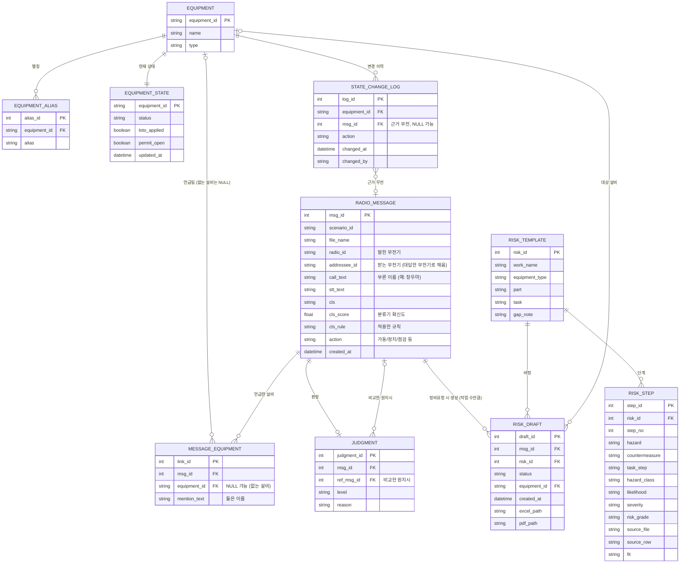

# AI 복창 확인 시스템 – DB 구조 (수정안 반영)

`radio_script.md`, `instruction_script.md`의 설비 상태와 라벨 정의를 기준으로 만들고,
팀원이 보낸 **ERD 수정안 5가지**를 반영한 버전입니다. ERD 그림은 `hackathon_erd.png`입니다.

## 수정 사항 (이전 초안 대비)

| # | 수정 | 이유 |
|---|---|---|
| ① | `judgment.ref_msg_id`를 점선이 아니라 **실선 외래키**로 (N : 0..1) | 비교한 원지시를 정식 관계로 연결 |
| ② | `message_equipment`: `equipment_id` **NULL 허용** + `mention_text` 추가, PK를 `link_id`로 변경 | DB에 없는 설비(7번·9번 컨베이어)도 저장 |
| ③ | `radio_message`에 `addressee_id`(받는 무전기), `action`(행위) 추가 | 복창 짝짓기, 정지↔가동 불일치 판정 |
| ④ | `radio_message → risk_draft`를 **1 : 0..1 → 1 : 0..N** | 작업이 2개면 초안도 2개 |
| ⑤ | `state_change_log.msg_id` 추가 (NULL 가능) | 버튼을 누른 근거가 된 무전을 기록 (감사용) |
| ⑥ | `radio_message`에 `call_text`(부른 이름), `cls_score`, `cls_rule` 추가 | 호출을 이름 그대로 저장, 분류기 판정 이유 표시 |
| ⑦ | `risk_template`·`risk_step`·`risk_draft`에 위험성평가 담당의 컬럼을 합침 | 표준 양식 칸과 출처, 초안의 설비·엑셀 경로 |

## 1. ERD



## 2. 표별 역할

| 표 | 역할 |
|---|---|
| EQUIPMENT | 설비 목록 (CV-01 ~ CV-05, CR-01, CR-02, FN-02) |
| EQUIPMENT_ALIAS | 설비 별칭 ("1컨", "오번 컨베이어" 등). 설비 정규화에 쓰는 사전 |
| EQUIPMENT_STATE | 설비의 **현재 상태** (정비 중, LOTO, 작업허가). 판정할 때 조회 |
| STATE_CHANGE_LOG | **담당자 버튼 조작 이력** (누가, 언제, 어떤 설비에, 무엇을, 근거 무전) |
| RADIO_MESSAGE | 무전 한 건 (STT 결과, CLS 분류와 확신도·규칙, 말한·받는 무전기, 부른 이름, 행위) |
| MESSAGE_EQUIPMENT | 한 무전이 언급한 설비 연결. **DB에 없는 설비**는 `equipment_id`가 NULL이고 들은 이름이 `mention_text`에 남음 |
| JUDGMENT | 판정 결과와 비교한 **원지시**(`ref_msg_id`) |
| RISK_TEMPLATE / RISK_STEP | 작업별 위험성 평가 양식과 단계 (세부작업, 분류, 위험 요인, 안전 대책, 가능성·중대성·위험성, 원본 출처) |
| RISK_DRAFT | 정비요청에서 생성된 위험성 평가 초안 (한 무전에 작업이 여러 개면 초안도 여러 개). 설비, 만든 시각, 엑셀 파일 위치 포함 |

> **이름 안내:** 기존 "JSA(작업안전분석)"를 팀 결정에 따라 **"위험성 평가"** 로 부릅니다. 표 이름도 `risk_template`, `risk_step`, `risk_draft`, 컬럼 이름은 `risk_id`로 바꿨습니다. (이전 이름: `jsa_template`, `jsa_step`, `jsa_draft`, `jsa_id`)

## 3. 값 정의 (제안)

| 컬럼 | 값 |
|---|---|
| EQUIPMENT_STATE.status | `READY`(운전 가능), `MAINTENANCE`(정비 중) |
| STATE_CHANGE_LOG.action | `MAINT_START`, `MAINT_DONE`, `LOTO_ON`, `LOTO_OFF`, `PERMIT_OPEN`, `PERMIT_CLOSE` (이 6개만 들어가도록 CHECK로 제한. 번역표는 8번 절) |
| RADIO_MESSAGE.cls | 정비요청, 가동지시, 정지지시, 복창, 상태보고, 기타, **불명**(분류기가 확신하지 못할 때). 분류 전이면 NULL. 팀 분류기(`cls/src/common.py`)의 라벨과 같음 |
| RADIO_MESSAGE.action | 가동, 리셋, 정지, 정지유지, 가동금지, 가동취소 (NER 사전 ACTION 정규값, 분류기의 `ACTION_TO_CLS`와 같음). 점검·청소 같은 정비 작업(TASK)을 어디에 저장할지는 미정 |
| JUDGMENT.level | `충돌`, `불일치`, `확인 필요`, `정상`, `기록` (ERD 수정안 표기를 따름) |
| RISK_DRAFT.status | `DRAFT`(초안), `APPROVED`(담당자 확정) |
| RADIO_MESSAGE.addressee_id | `A`/`B`/`C`. 지시 뒤에 처음 대답(복창·되묻기)한 무전기로 채움. 이름(창우야 등)은 `call_text`에 따로 둠 |
| RADIO_MESSAGE.cls_score / cls_rule | 분류기 결과. 규칙으로 정해진 문장은 점수가 NULL이고 규칙 이름(예: `P5 가동+지시 어미`)만 남음 |
| RISK_TEMPLATE.equipment_type | `conveyor`, `crusher`, `fan` (EQUIPMENT.type과 같은 값) |
| RISK_STEP.fit | `직접`(같은 작업의 표준 데이터), `유사`(비슷한 작업에서 가져온 것) |

## 4. SQLite 생성문

참조되는 표가 먼저 만들어지도록 순서를 정리했습니다.

```sql
CREATE TABLE equipment (
  equipment_id TEXT PRIMARY KEY,
  name         TEXT NOT NULL,
  type         TEXT NOT NULL            -- conveyor / crusher / fan
);

CREATE TABLE equipment_alias (
  alias_id     INTEGER PRIMARY KEY AUTOINCREMENT,
  equipment_id TEXT NOT NULL REFERENCES equipment(equipment_id),
  alias        TEXT NOT NULL UNIQUE
);

-- [규칙] 가동 지시의 충돌 판정은 status 가 아니라 loto_applied·permit_open 으로 한다.
--        (대본: LOTO 또는 작업허가가 걸린 설비에 가동 지시 = 충돌)
CREATE TABLE equipment_state (
  equipment_id TEXT PRIMARY KEY REFERENCES equipment(equipment_id),
  status       TEXT NOT NULL CHECK (status IN ('READY','MAINTENANCE')),
  loto_applied INTEGER NOT NULL DEFAULT 0,   -- 0/1
  permit_open  INTEGER NOT NULL DEFAULT 0,   -- 0/1
  updated_at   TEXT
);

CREATE TABLE radio_message (
  msg_id       INTEGER PRIMARY KEY AUTOINCREMENT,
  scenario_id  TEXT,
  file_name    TEXT,
  radio_id     TEXT,                       -- 말한 무전기 (A / B / C)
  addressee_id TEXT,                       -- 받는 무전기 (③ 추가). 지시 뒤에 복창한 무전기로 채움
  call_text    TEXT,                       -- 부른 이름 (예: 창우야). 호출이 없으면 NULL
  stt_text     TEXT,
  cls          TEXT CHECK (cls IN ('정비요청','가동지시','정지지시','복창','상태보고','기타','불명')),  -- NULL = 아직 분류 전 (cls/src 분류기 라벨)
  cls_score    REAL,                       -- 분류기 확신도 (규칙으로 정해지면 NULL)  [CLS 담당 추가]
  cls_rule     TEXT,                       -- 분류기가 적용한 규칙 (예: P5 가동+지시 어미)  [CLS 담당 추가]
  action       TEXT,                       -- 가동 / 리셋 / 정지 / 정지유지 / 가동금지 / 가동취소 (NER 사전 ACTION 값, ③ 추가)
  created_at   TEXT
);

CREATE TABLE message_equipment (
  link_id      INTEGER PRIMARY KEY AUTOINCREMENT,                -- ② PK 변경
  msg_id       INTEGER NOT NULL REFERENCES radio_message(msg_id),
  equipment_id TEXT REFERENCES equipment(equipment_id),          -- ② NULL 가능 (DB에 없는 설비)
  mention_text TEXT                                              -- ② 들은 이름 (예: 7번 컨베이어)
);

-- [규칙] 버튼별로 바뀌는 칸은 state_actions.csv 에 있다. 작업허가 종료(PERMIT_CLOSE)는 permit_open=0 으로 바꾸고,
--        loto_applied 가 0 일 때만 status 도 READY 로 바꾼다 (LOTO 가 걸린 설비는 정비 중으로 남는다).
CREATE TABLE state_change_log (
  log_id       INTEGER PRIMARY KEY AUTOINCREMENT,
  equipment_id TEXT NOT NULL REFERENCES equipment(equipment_id),
  msg_id       INTEGER REFERENCES radio_message(msg_id),         -- ⑤ 근거 무전 (NULL 가능)
  action       TEXT NOT NULL CHECK (action IN ('MAINT_START','MAINT_DONE','LOTO_ON','LOTO_OFF','PERMIT_OPEN','PERMIT_CLOSE')),   -- 담당자 버튼 6개 (state_actions.csv)
  changed_at   TEXT NOT NULL,
  changed_by   TEXT
);

CREATE TABLE judgment (
  judgment_id INTEGER PRIMARY KEY AUTOINCREMENT,
  msg_id      INTEGER NOT NULL REFERENCES radio_message(msg_id),
  ref_msg_id  INTEGER REFERENCES radio_message(msg_id),          -- ① 비교한 원지시 (실선 FK)
  level       TEXT NOT NULL CHECK (level IN ('충돌','불일치','확인 필요','정상','기록')),
  reason      TEXT
);

CREATE TABLE risk_template (
  risk_id        INTEGER PRIMARY KEY AUTOINCREMENT,
  work_name      TEXT NOT NULL,            -- 예: 롤러 점검, 낙광 청소
  equipment_type TEXT,                     -- conveyor / crusher / fan  [위험성평가 담당 추가]
  part           TEXT,                     -- NER PART 정규값 (예: 롤러)
  task           TEXT,                     -- NER TASK 정규값 (예: 점검)
  gap_note       TEXT                      -- 표준 데이터에 없는 부분
);

CREATE TABLE risk_step (
  step_id        INTEGER PRIMARY KEY AUTOINCREMENT,
  risk_id        INTEGER NOT NULL REFERENCES risk_template(risk_id),
  step_no        INTEGER NOT NULL,
  hazard         TEXT,
  countermeasure TEXT,
  task_step      TEXT,                     -- 세부작업 (작업 준비 / 작업명 / 작업 마무리)  [위험성평가 담당 추가]
  hazard_class   TEXT,                     -- 분류 (6대 위험요인)
  likelihood     TEXT,                     -- 가능성 (원본에 없으면 NULL)
  severity       TEXT,                     -- 중대성 (원본에 없으면 NULL)
  risk_grade     TEXT,                     -- 위험성 (원본에 없으면 NULL)
  source_file    TEXT,                     -- 원본 위험성평가 파일
  source_row     TEXT,                     -- 원본 행 번호
  fit            TEXT                      -- 직접 / 유사
);

CREATE TABLE risk_draft (
  draft_id     INTEGER PRIMARY KEY AUTOINCREMENT,
  msg_id       INTEGER NOT NULL REFERENCES radio_message(msg_id),   -- ④ 한 무전에 여러 건 가능
  risk_id      INTEGER REFERENCES risk_template(risk_id),
  status       TEXT NOT NULL DEFAULT 'DRAFT',
  equipment_id TEXT REFERENCES equipment(equipment_id),             -- [위험성평가 담당 추가] 초안의 설비
  created_at   TEXT,                                                -- 만든 시각
  excel_path   TEXT,                                                -- 생성한 엑셀 파일 위치 (저장소 기준 상대경로)
  pdf_path     TEXT                                                 -- 같은 내용을 PDF로 바꾼 파일 위치
);
```

## 5. 초기 데이터 (radio_script 기준)

```sql
INSERT INTO equipment VALUES
  ('CV-01','1번 컨베이어','conveyor'),
  ('CV-02','2번 컨베이어','conveyor'),
  ('CV-03','3번 컨베이어','conveyor'),
  ('CV-04','4번 컨베이어','conveyor'),
  ('CV-05','5번 컨베이어','conveyor'),
  ('CR-01','1호기 파쇄기','crusher'),
  ('CR-02','2호기 파쇄기','crusher'),
  ('FN-02','2번 송풍기','fan');

INSERT INTO equipment_state (equipment_id, status, loto_applied, permit_open) VALUES
  ('CV-01','READY',0,0),
  ('CV-02','READY',0,0),
  ('CV-03','READY',0,0),
  ('CV-04','MAINTENANCE',1,0),   -- 정비 중, LOTO 적용
  ('CV-05','READY',0,0),
  ('CR-01','READY',0,0),
  ('CR-02','READY',0,0),
  ('FN-02','MAINTENANCE',0,1);   -- 정비 작업허가 진행 중, LOTO 미적용

INSERT INTO equipment_alias (equipment_id, alias) VALUES
  ('CV-01','1번 컨베이어'),('CV-01','일번 컨베이어'),('CV-01','1컨'),('CV-01','1번 벨트'),
  ('CV-02','2번 컨베이어'),('CV-02','2컨'),('CV-02','2번 벨트'),('CV-02','두 번째 컨베이어'),
  ('CV-03','3번 컨베이어'),('CV-03','삼번 컨베이어'),('CV-03','3컨'),('CV-03','3번 벨트'),
  ('CV-04','4번 컨베이어'),('CV-04','사번 컨베이어'),('CV-04','4컨'),('CV-04','4번 라인 컨베이어'),
  ('CV-05','5번 컨베이어'),('CV-05','오번 컨베이어'),('CV-05','5컨'),
  ('CR-01','1호기 파쇄기'),('CR-01','1호 파쇄기'),('CR-01','1호기 크러셔'),
  ('CR-02','2호기 파쇄기'),('CR-02','2호 파쇄기'),('CR-02','2호기 크러셔'),
  ('FN-02','2번 송풍기'),('FN-02','2번 블로워');
```

## 6. 아직 정해지지 않은 것

1. **"이번 컨베이어"**: radio_script 별칭 표에는 CV-02의 별칭인데 S08 #54에서는 "설비 모호"로 처리됨. 위 초기 데이터에서는 **일단 뺐습니다.**
2. **CLS 라벨**: 분류기 기준으로 `불명`을 포함해 7개로 정해짐 (DB에 CHECK로 반영). 남은 것: instruction_script의 복합 라벨 `정비요청 + 가동지시`는 분류기에 없음.
3. **"2번 다시 켜"**처럼 번호만 말해 컨베이어(CV-02)와 송풍기(FN-02)가 모두 후보인 경우의 처리.
4. **`radio_message.action`의 값 목록**은 NER 사전 기준 6개로 정해짐. 남은 것: AI 출력 형식, 정비 작업(TASK)을 저장할 위치.
5. 신뢰도는 `cls_score`로 반영됨. 남은 것: 작업 내용(`work_detail`), 누락 항목(`missing`). 필요하면 이후 추가.
6. 상태 변경은 **담당자 버튼**으로만 하므로, `equipment_state`를 바꾸는 코드는 버튼 처리 한 곳에만 두고 `state_change_log`에 같이 기록.

## 7. 팀원이 추가한 컬럼과 위험성 평가 데이터 (이번 반영)

팀원이 `hackathon_db_schema2.md`에서 ALTER로 덧붙인 컬럼을 위 SQL(`schema.sql`)의 CREATE 안으로 합쳤습니다.
DB를 사람마다 따로 만들면 구조가 달라지므로, **이 문서와 `schema.sql`을 기준으로 맞추는 것**을 권합니다.

| 표 | 추가된 칸 | 추가한 사람, 이유 |
|---|---|---|
| radio_message | `cls_score`, `cls_rule` | CLS 담당. 분류기 확신도와 적용 규칙 (화면에 판정 이유 표시) |
| radio_message | `call_text` | DB 담당. 부른 이름(창우야 등)을 글자 그대로 저장 |
| risk_template | `equipment_type`, `part`, `task`, `gap_note` | 위험성평가 담당. NER의 부품·작업 값으로 양식을 찾기 위함 |
| risk_step | `task_step`, `hazard_class`, `likelihood`, `severity`, `risk_grade`, `source_file`, `source_row`, `fit` | 위험성평가 담당. 표준 양식 칸과 출처 |
| risk_draft | `equipment_id`, `created_at`, `excel_path` | 위험성평가 담당. 초안의 설비, 시각, 엑셀 위치 |
| risk_draft | `pdf_path` | DB 담당. 엑셀을 PDF로 바꾼 파일 위치 (`risk/output/` 안의 파일을 가리킴) |

**위험성 평가 정답지 데이터**는 `db/risk_data.sql`에 있습니다(양식 9개, 단계 48행). 한국가스공사 위험성평가 표준모델 원문이고 출처 파일·행이 붙어 있으며, 가능성·중대성·위험성은 원본에 값이 없어 NULL입니다. `python build_db.py --with-risk-data`로 넣습니다.

**받는 무전기(`addressee_id`)** 는 이름이 아니라 **대답한 사람**으로 채웁니다(`build_db.py --classify`). 호출부호가 있는 대본 지시 28건 모두 정답과 같았습니다.

> `hackathon_db_schema2.md`는 이 문서의 이전 버전에 7번 절만 덧붙인 것이라 내용이 겹칩니다. 합친 뒤에는 하나만 남기는 것이 좋습니다.

**추출 결과 합치기** (`build_db.py --with-stt --with-llm-results`): `stt/llm_results.csv`의 설비·행위·분류를 **구조 변경 없이** 기존 칸에 넣습니다.

| llm_results 열 | 들어가는 곳 |
|---|---|
| `action` (`없음`은 NULL) | `radio_message.action` |
| `equipment_ids`, `equipment_mentions` | `message_equipment` (DB에 없는 설비는 `equipment_id` NULL + 들은 이름) |
| `cls` | `radio_message.cls` (비어 있을 때만) |
| `addressee` | 복창일 때만 `addressee_id` (지시의 받는 무전기는 대답한 무전기로 채움) |
| `corrected_text` | 기본은 쓰지 않음 (`--llm-text`를 주면 `stt_text`로 교체) |
| `tasks`, `equipment_guess`, `uncertain`, `uncertain_reason`, `inherited`, `is_question`, `eq_type` | **DB에 칸이 없어 넣지 않음** (필요하면 CSV를 직접 읽음) |

문장은 기존 STT 보정본(`stt_results.csv`의 `hyp_post`)을 쓰고, `llm_results.csv`에서 설비를 못 찾은 무전은 **문장 속 별칭으로 보완**합니다(`mention_text`에 찾은 별칭을 적음). `llm_results.csv`의 추출이 새 STT 실행 문장 기준이라 기존 문장과 어긋나는 경우(예: S01_01_A, S01_04_A에서 "3"이 빠짐)를 메우기 위한 것입니다.

설비를 말하지 않아 직전 교신으로 추정한 값(`equipment_guess` 칸에 값이 있는 무전, 예: S08_05_A "그 컨베이어")은 설비를 연결하지 않습니다. 사실이 아닌 추정이라 판정이 "확인 필요"로 보게 하기 위해서입니다. 호출 이름 여부(`called_by_name`) 등 새로 늘어난 열은 DB에 넣지 않고 무시합니다.

## 8. 상태 값 번역표 (NER 사전 ↔ DB)

무전에서 뽑은 상태 값(NER 사전의 `STATE`)과 DB의 버튼 값(`state_change_log.action`)은 이름이 달라서 번역표를 두었습니다.
**이 표는 DB를 자동으로 바꾸지 않습니다.** 상태는 담당자 버튼으로만 바뀌고, 표는 "이 무전이 들렸으니 어느 버튼을 권할지"를 정하는 용도입니다.
파일은 두 개이고, 코드에서 그대로 읽어 쓸 수 있습니다.

### 8-1. `state_actions.csv` — 버튼 6개가 바꾸는 칸

| 버튼 값 | 화면 버튼 | 바뀌는 칸 | 비고 |
|---|---|---|---|
| `MAINT_START` | 정비 시작 | `status` → `MAINTENANCE` | |
| `MAINT_DONE` | 정비 완료 | `status` → `READY` | LOTO 해제는 별도 버튼 |
| `LOTO_ON` | LOTO 적용 | `loto_applied` → 1 | |
| `LOTO_OFF` | LOTO 해제 | `loto_applied` → 0 | |
| `PERMIT_OPEN` | 작업허가 시작 | `permit_open` → 1 | 말로는 잘 나오지 않아 직접 누름 |
| `PERMIT_CLOSE` | 작업허가 종료 | `permit_open` → 0 | `loto_applied`가 0이면 `status`도 `READY` |

**충돌 판정은 `status`가 아니라 `loto_applied`·`permit_open`으로 합니다.** 대본이 "LOTO 또는 작업허가가 걸린 설비에 가동 지시"를 충돌로 정했기 때문입니다.

### 8-2. `state_mapping.csv` — 어느 상태 값이 어느 버튼과 연결되나

| NER 상태 값 | 권하는 버튼 | 구분 |
|---|---|---|
| `LOTO적용` | `LOTO_ON` + `MAINT_START` (함께) | 버튼 권장 (대본 S01 #3) |
| `LOTO해제` | `LOTO_OFF` | 버튼 권장 (S01 #8) |
| `정비완료` | `MAINT_DONE` | 버튼 권장 (S01 #8) |
| `작업허가종료` | `PERMIT_CLOSE` | 버튼 권장 (S05 #35) |
| `작업완료` | `PERMIT_CLOSE` | 약하게 권장 ("끝났습니다"만 들린 경우) |
| (말이 없음) | `PERMIT_OPEN` | 담당자가 직접 누름 |
| `LOTO`(오인식), `순찰완료`, `이상없음`, `이상`, `사람있음`, `정지확인`, `인터록`, `작업허가`, `트립` | 없음 | 기록만 |

한 문장에서 상태 값이 둘 이상 뽑히면(예: "정비 완료, LOTO 해제했습니다" → `정비완료` + `LOTO해제`) 권하는 버튼을 합쳐서 띄웁니다.

## 9. DB 함수 모음 (`db_api.py`)

SQL을 몰라도 쓸 수 있게 자주 쓰는 동작을 함수로 묶었습니다. 필요한 팀원이 가져다 쓰면 됩니다(필수 아님).

```python
import sys; sys.path.insert(0, "db")      # 저장소 맨 위 폴더에서 실행할 때
import db_api

db_api.get_state("CV-03")                          # 현재 상태. start_blocked 가 True 면 가동 지시가 충돌
db_api.suggest_buttons(["정비완료", "LOTO해제"])     # 무전에서 뽑은 상태 값 → 화면에 띄울 버튼
db_api.press_button("CV-03", "LOTO_ON", msg_id=3)  # 담당자 버튼: 상태 변경 + 기록
db_api.reset_scene("S01")                          # 시연 장면을 처음 상태로 되돌리기
```

| 함수 | 하는 일 | 주로 쓰는 곳 |
|---|---|---|
| `get_state`, `get_all_states` | 설비 상태 조회 | 현황판, 판정 |
| `suggest_buttons` | 상태 값 → 권하는 버튼 (`state_mapping.csv`) | 화면 |
| `press_button` | 버튼 처리 (상태 변경 + `state_change_log` 기록) | 화면 |
| `reset_scene`, `scene_buttons_after` | 장면 처음 상태로, 무전 다음에 누르는 버튼 (`scenes.csv`) | 시연 |
| `find_equipment` | 문장 속 별칭 → 설비 번호 | 추출 |
| `save_message`, `save_judgment` | 무전, 판정 저장 | 추출, 판정 |
| `list_messages` | 무전 목록 (설비·최근 판정 포함) | 이력 화면 |

- 먼저 `python db/build_db.py`로 DB 파일을 만들어야 합니다. 시험은 `python db/test_db_api.py`입니다.
- 상태는 `press_button`으로만 바꾸는 것이 원칙입니다(기록이 함께 남도록).
- `find_equipment`는 "5번."처럼 번호만 있거나 "3번이랑 4번"처럼 줄여 말한 것은 찾지 못합니다(별칭에 없으므로).

## 10. 판정 로직 (db/judge.py)

무전을 순서대로 읽으며 충돌/불일치/확인 필요/정상/기록을 정하고 `judgment` 표에 저장하는 규칙 기반 코드입니다 (DB 구조는 그대로).
팀에서 쓰면 쓰고, 안 쓰면 그대로 둬도 됩니다.

```
python db/judge.py --scene S01        # 장면 하나 판정 (저장 + 화면 출력)
python db/judge.py --no-save          # 전체를 저장 없이 화면에만
import judge; judge.judge_message(msg, pending, get_state)   # 무전 한 건만 판정 (실시간 연결용)
```

- 기록: 상태보고·기타 / 정상: 정비요청·정지 지시·막힌 것 없는 가동 지시·일치하는 복창
- 충돌: 가동 지시인데 그 설비에 LOTO 나 작업허가가 걸림 (충돌 지시에 대한 복창이 일치해도 충돌 유지)
- 불일치: 복창의 설비 번호나 가동/정지가 원지시와 다름 (없는 설비 포함)
- 확인 필요: 지시의 설비가 없음·모호·DB에 없음, 원지시가 모호한데 복창이 옴
- "아니, 가동." 처럼 설비 없이 정정하면 직전 지시의 설비를 이어받음
- 설비 상태는 장면의 담당자 버튼(scenes.csv) 순서대로 바뀐 상태로 판정
- 시험: `python db/test_judge.py` — 대본 예상 판정 101개(`expected_judgments.csv`)와 모두 일치.
  S08_01_A("이번 컨베이어")는 대본에서는 확인 필요였지만, 앞뒤 맥락상 2번이 맞아 보정된 문장 그대로 정상으로 판정(기대값을 정상으로 고침)
