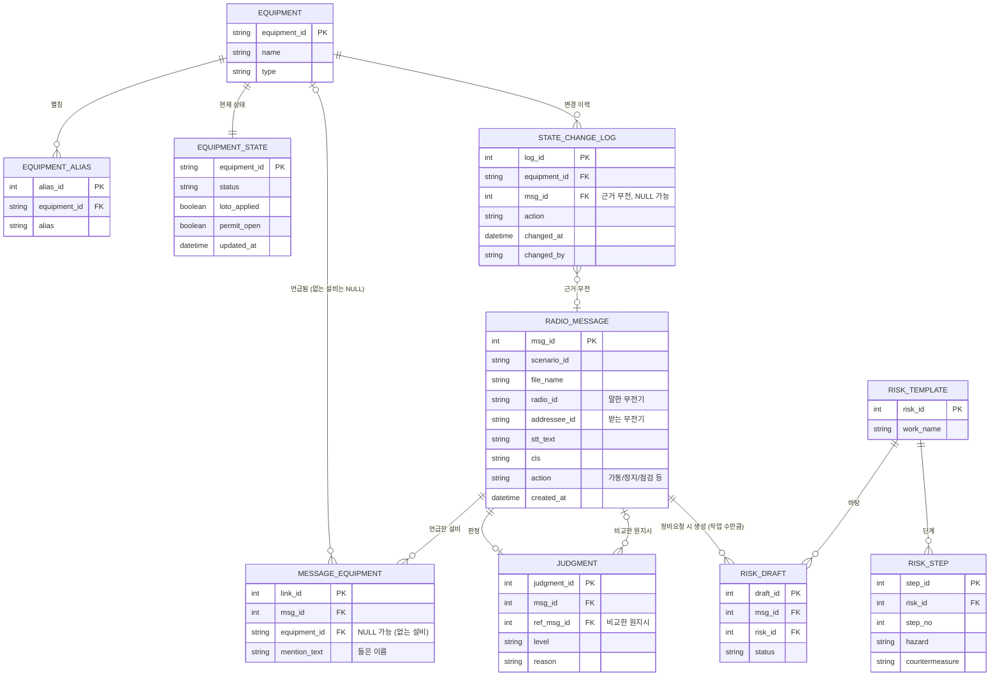

# AI 복창 확인 시스템 – DB 구조 (수정안 반영)

`radio_script.md`, `instruction_script.md`의 설비 상태와 라벨 정의를 기준으로 만들고,
팀원이 보낸 **ERD 수정안 5가지**를 반영한 버전입니다. ERD 그림은 `hackathon_erd.png`입니다.

## 수정 사항 (이전 초안 대비)

| # | 수정 | 이유 |
|---|---|---|
| ① | `judgment.ref_msg_id`를 점선이 아니라 **실선 외래키**로 (N : 0..1) | 비교한 원지시를 정식 관계로 연결 |
| ② | `message_equipment`: `equipment_id` **NULL 허용** + `mention_text` 추가, PK를 `link_id`로 변경 | DB에 없는 설비(7번·9번 컨베이어)도 저장 |
| ③ | `radio_message`에 `addressee_id`(받는 무전기), `action`(행위) 추가 | 복창 짝짓기, 정지↔가동 불일치 판정 |
| ④ | `radio_message → risk_draft`를 **1 : 0..1 → 1 : 0..N** | 작업이 2개면 초안도 2개 |
| ⑤ | `state_change_log.msg_id` 추가 (NULL 가능) | 버튼을 누른 근거가 된 무전을 기록 (감사용) |

## 1. ERD



## 2. 표별 역할

| 표 | 역할 |
|---|---|
| EQUIPMENT | 설비 목록 (CV-01 ~ CV-05, CR-01, CR-02, FN-02) |
| EQUIPMENT_ALIAS | 설비 별칭 ("1컨", "오번 컨베이어" 등). 설비 정규화에 쓰는 사전 |
| EQUIPMENT_STATE | 설비의 **현재 상태** (정비 중, LOTO, 작업허가). 판정할 때 조회 |
| STATE_CHANGE_LOG | **담당자 버튼 조작 이력** (누가, 언제, 어떤 설비에, 무엇을, 근거 무전) |
| RADIO_MESSAGE | 무전 한 건 (STT 결과, CLS 분류, 말한·받는 무전기, 행위) |
| MESSAGE_EQUIPMENT | 한 무전이 언급한 설비 연결. **DB에 없는 설비**는 `equipment_id`가 NULL이고 들은 이름이 `mention_text`에 남음 |
| JUDGMENT | 판정 결과와 비교한 **원지시**(`ref_msg_id`) |
| RISK_TEMPLATE / RISK_STEP | 작업별 위험성 평가 양식과 단계 (작업 단계, 위험 요인, 안전 대책) |
| RISK_DRAFT | 정비요청에서 생성된 위험성 평가 초안 (한 무전에 작업이 여러 개면 초안도 여러 개) |

> **이름 안내:** 기존 "JSA(작업안전분석)"를 팀 결정에 따라 **"위험성 평가"** 로 부릅니다. 표 이름도 `risk_template`, `risk_step`, `risk_draft`, 컬럼 이름은 `risk_id`로 바꿨습니다. (이전 이름: `jsa_template`, `jsa_step`, `jsa_draft`, `jsa_id`)

## 3. 값 정의 (제안)

| 컬럼 | 값 |
|---|---|
| EQUIPMENT_STATE.status | `READY`(운전 가능), `MAINTENANCE`(정비 중) |
| STATE_CHANGE_LOG.action | `MAINT_START`, `MAINT_DONE`, `LOTO_ON`, `LOTO_OFF`, `PERMIT_OPEN`, `PERMIT_CLOSE` |
| RADIO_MESSAGE.cls | 정비요청, 가동지시, 정지지시, 복창, 상태보고, 기타, **불명**(분류기가 확신하지 못할 때). 분류 전이면 NULL. 팀 분류기(`cls/src/common.py`)의 라벨과 같음 |
| RADIO_MESSAGE.action | 가동, 리셋, 정지, 정지유지, 가동금지, 가동취소 (NER 사전 ACTION 정규값, 분류기의 `ACTION_TO_CLS`와 같음). 점검·청소 같은 정비 작업(TASK)을 어디에 저장할지는 미정 |
| JUDGMENT.level | `충돌`, `불일치`, `확인 필요`, `정상`, `기록` (ERD 수정안 표기를 따름) |
| RISK_DRAFT.status | `DRAFT`(초안), `APPROVED`(담당자 확정) |

## 4. SQLite 생성문

참조되는 표가 먼저 만들어지도록 순서를 정리했습니다.

```sql
CREATE TABLE equipment (
  equipment_id TEXT PRIMARY KEY,
  name         TEXT NOT NULL,
  type         TEXT NOT NULL            -- conveyor / crusher / fan
);

CREATE TABLE equipment_alias (
  alias_id     INTEGER PRIMARY KEY AUTOINCREMENT,
  equipment_id TEXT NOT NULL REFERENCES equipment(equipment_id),
  alias        TEXT NOT NULL UNIQUE
);

CREATE TABLE equipment_state (
  equipment_id TEXT PRIMARY KEY REFERENCES equipment(equipment_id),
  status       TEXT NOT NULL CHECK (status IN ('READY','MAINTENANCE')),
  loto_applied INTEGER NOT NULL DEFAULT 0,   -- 0/1
  permit_open  INTEGER NOT NULL DEFAULT 0,   -- 0/1
  updated_at   TEXT
);

CREATE TABLE radio_message (
  msg_id       INTEGER PRIMARY KEY AUTOINCREMENT,
  scenario_id  TEXT,
  file_name    TEXT,
  radio_id     TEXT,                       -- 말한 무전기 (A / B / C)
  addressee_id TEXT,                       -- 받는 무전기 (③ 추가)
  stt_text     TEXT,
  cls          TEXT CHECK (cls IN ('정비요청','가동지시','정지지시','복창','상태보고','기타','불명')),  -- NULL = 아직 분류 전 (cls/src 분류기 라벨)
  action       TEXT,                       -- 가동 / 리셋 / 정지 / 정지유지 / 가동금지 / 가동취소 (NER 사전 ACTION 값, ③ 추가)
  created_at   TEXT
);

CREATE TABLE message_equipment (
  link_id      INTEGER PRIMARY KEY AUTOINCREMENT,                -- ② PK 변경
  msg_id       INTEGER NOT NULL REFERENCES radio_message(msg_id),
  equipment_id TEXT REFERENCES equipment(equipment_id),          -- ② NULL 가능 (DB에 없는 설비)
  mention_text TEXT                                              -- ② 들은 이름 (예: 7번 컨베이어)
);

CREATE TABLE state_change_log (
  log_id       INTEGER PRIMARY KEY AUTOINCREMENT,
  equipment_id TEXT NOT NULL REFERENCES equipment(equipment_id),
  msg_id       INTEGER REFERENCES radio_message(msg_id),         -- ⑤ 근거 무전 (NULL 가능)
  action       TEXT NOT NULL,
  changed_at   TEXT NOT NULL,
  changed_by   TEXT
);

CREATE TABLE judgment (
  judgment_id INTEGER PRIMARY KEY AUTOINCREMENT,
  msg_id      INTEGER NOT NULL REFERENCES radio_message(msg_id),
  ref_msg_id  INTEGER REFERENCES radio_message(msg_id),          -- ① 비교한 원지시 (실선 FK)
  level       TEXT NOT NULL CHECK (level IN ('충돌','불일치','확인 필요','정상','기록')),
  reason      TEXT
);

CREATE TABLE risk_template (
  risk_id    INTEGER PRIMARY KEY AUTOINCREMENT,
  work_name TEXT NOT NULL               -- 예: 롤러 점검, 낙광 청소
);

CREATE TABLE risk_step (
  step_id        INTEGER PRIMARY KEY AUTOINCREMENT,
  risk_id         INTEGER NOT NULL REFERENCES risk_template(risk_id),
  step_no        INTEGER NOT NULL,
  hazard         TEXT,
  countermeasure TEXT
);

CREATE TABLE risk_draft (
  draft_id INTEGER PRIMARY KEY AUTOINCREMENT,
  msg_id   INTEGER NOT NULL REFERENCES radio_message(msg_id),    -- ④ 한 무전에 여러 건 가능
  risk_id   INTEGER REFERENCES risk_template(risk_id),
  status   TEXT NOT NULL DEFAULT 'DRAFT'
);
```

## 5. 초기 데이터 (radio_script 기준)

```sql
INSERT INTO equipment VALUES
  ('CV-01','1번 컨베이어','conveyor'),
  ('CV-02','2번 컨베이어','conveyor'),
  ('CV-03','3번 컨베이어','conveyor'),
  ('CV-04','4번 컨베이어','conveyor'),
  ('CV-05','5번 컨베이어','conveyor'),
  ('CR-01','1호기 파쇄기','crusher'),
  ('CR-02','2호기 파쇄기','crusher'),
  ('FN-02','2번 송풍기','fan');

INSERT INTO equipment_state (equipment_id, status, loto_applied, permit_open) VALUES
  ('CV-01','READY',0,0),
  ('CV-02','READY',0,0),
  ('CV-03','READY',0,0),
  ('CV-04','MAINTENANCE',1,0),   -- 정비 중, LOTO 적용
  ('CV-05','READY',0,0),
  ('CR-01','READY',0,0),
  ('CR-02','READY',0,0),
  ('FN-02','MAINTENANCE',0,1);   -- 정비 작업허가 진행 중, LOTO 미적용

INSERT INTO equipment_alias (equipment_id, alias) VALUES
  ('CV-01','1번 컨베이어'),('CV-01','일번 컨베이어'),('CV-01','1컨'),('CV-01','1번 벨트'),
  ('CV-02','2번 컨베이어'),('CV-02','2컨'),('CV-02','2번 벨트'),('CV-02','두 번째 컨베이어'),
  ('CV-03','3번 컨베이어'),('CV-03','삼번 컨베이어'),('CV-03','3컨'),('CV-03','3번 벨트'),
  ('CV-04','4번 컨베이어'),('CV-04','사번 컨베이어'),('CV-04','4컨'),('CV-04','4번 라인 컨베이어'),
  ('CV-05','5번 컨베이어'),('CV-05','오번 컨베이어'),('CV-05','5컨'),
  ('CR-01','1호기 파쇄기'),('CR-01','1호 파쇄기'),('CR-01','1호기 크러셔'),
  ('CR-02','2호기 파쇄기'),('CR-02','2호 파쇄기'),('CR-02','2호기 크러셔'),
  ('FN-02','2번 송풍기'),('FN-02','2번 블로워');
```

## 6. 아직 정해지지 않은 것

1. **"이번 컨베이어"**: radio_script 별칭 표에는 CV-02의 별칭인데 S08 #54에서는 "설비 모호"로 처리됨. 위 초기 데이터에서는 **일단 뺐습니다.**
2. **CLS 라벨**: 분류기 기준으로 `불명`을 포함해 7개로 정해짐 (DB에 CHECK로 반영). 남은 것: instruction_script의 복합 라벨 `정비요청 + 가동지시`는 분류기에 없음.
3. **"2번 다시 켜"**처럼 번호만 말해 컨베이어(CV-02)와 송풍기(FN-02)가 모두 후보인 경우의 처리.
4. **`radio_message.action`의 값 목록**은 NER 사전 기준 6개로 정해짐. 남은 것: AI 출력 형식, 정비 작업(TASK)을 저장할 위치.
5. 이번 수정안에 **들어 있지 않은 것**: 신뢰도(confidence), 작업 내용(`work_detail`), 누락 항목(`missing`). 필요하면 이후 추가.
6. 상태 변경은 **담당자 버튼**으로만 하므로, `equipment_state`를 바꾸는 코드는 버튼 처리 한 곳에만 두고 `state_change_log`에 같이 기록.
