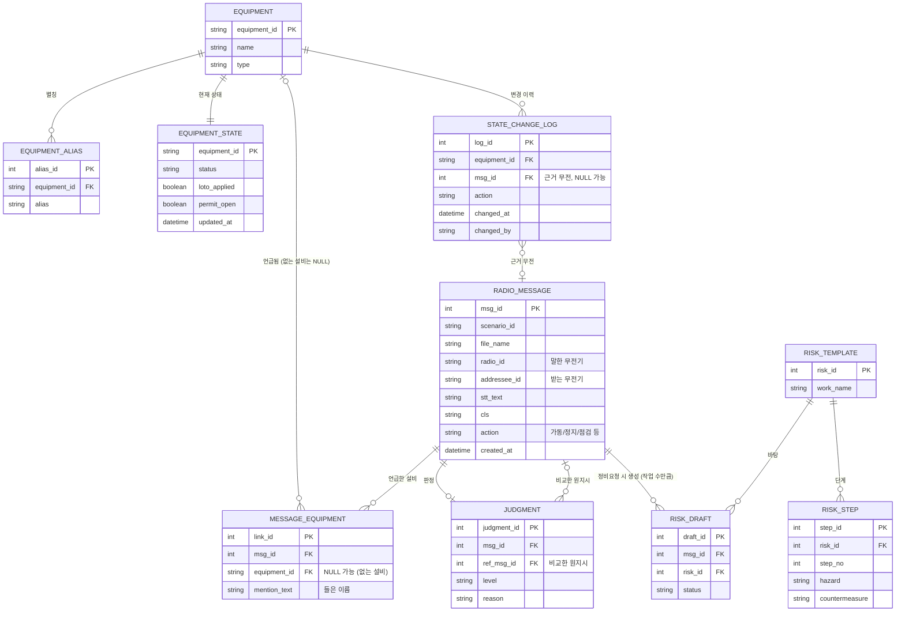

# AI 복창 확인 시스템 – DB 구조 (수정안 반영)

`radio_script.md`, `instruction_script.md`의 설비 상태와 라벨 정의를 기준으로 만들고,
팀원이 보낸 **ERD 수정안 5가지**를 반영한 버전입니다. ERD 그림은 `hackathon_erd.png`입니다.

## 수정 사항 (이전 초안 대비)

| # | 수정 | 이유 |
|---|---|---|
| ① | `judgment.ref_msg_id`를 점선이 아니라 **실선 외래키**로 (N : 0..1) | 비교한 원지시를 정식 관계로 연결 |
| ② | `message_equipment`: `equipment_id` **NULL 허용** + `mention_text` 추가, PK를 `link_id`로 변경 | DB에 없는 설비(7번·9번 컨베이어)도 저장 |
| ③ | `radio_message`에 `addressee_id`(받는 무전기), `action`(행위) 추가 | 복창 짝짓기, 정지↔가동 불일치 판정 |
| ④ | `radio_message → risk_draft`를 **1 : 0..1 → 1 : 0..N** | 작업이 2개면 초안도 2개 |
| ⑤ | `state_change_log.msg_id` 추가 (NULL 가능) | 버튼을 누른 근거가 된 무전을 기록 (감사용) |

## 1. ERD



## 2. 표별 역할

| 표 | 역할 |
|---|---|
| EQUIPMENT | 설비 목록 (CV-01 ~ CV-05, CR-01, CR-02, FN-02) |
| EQUIPMENT_ALIAS | 설비 별칭 ("1컨", "오번 컨베이어" 등). 설비 정규화에 쓰는 사전 |
| EQUIPMENT_STATE | 설비의 **현재 상태** (정비 중, LOTO, 작업허가). 판정할 때 조회 |
| STATE_CHANGE_LOG | **담당자 버튼 조작 이력** (누가, 언제, 어떤 설비에, 무엇을, 근거 무전) |
| RADIO_MESSAGE | 무전 한 건 (STT 결과, CLS 분류, 말한·받는 무전기, 행위) |
| MESSAGE_EQUIPMENT | 한 무전이 언급한 설비 연결. **DB에 없는 설비**는 `equipment_id`가 NULL이고 들은 이름이 `mention_text`에 남음 |
| JUDGMENT | 판정 결과와 비교한 **원지시**(`ref_msg_id`) |
| RISK_TEMPLATE / RISK_STEP | 작업별 위험성 평가 양식과 단계 (작업 단계, 위험 요인, 안전 대책) |
| RISK_DRAFT | 정비요청에서 생성된 위험성 평가 초안 (한 무전에 작업이 여러 개면 초안도 여러 개) |

> **이름 안내:** 기존 "JSA(작업안전분석)"를 팀 결정에 따라 **"위험성 평가"** 로 부릅니다. 표 이름도 `risk_template`, `risk_step`, `risk_draft`, 컬럼 이름은 `risk_id`로 바꿨습니다. (이전 이름: `jsa_template`, `jsa_step`, `jsa_draft`, `jsa_id`)

## 3. 값 정의 (제안)

| 컬럼 | 값 |
|---|---|
| EQUIPMENT_STATE.status | `READY`(운전 가능), `MAINTENANCE`(정비 중) |
| STATE_CHANGE_LOG.action | `MAINT_START`, `MAINT_DONE`, `LOTO_ON`, `LOTO_OFF`, `PERMIT_OPEN`, `PERMIT_CLOSE` |
| RADIO_MESSAGE.cls | 정비요청, 가동지시, 정지지시, 복창, 상태보고, 기타 (**`불명` 등 추가 여부는 팀 결정 필요**) |
| RADIO_MESSAGE.action | 가동, 정지, 점검 등 (**값 목록은 AI 담당과 합의 필요**) |
| JUDGMENT.level | `충돌`, `불일치`, `확인 필요`, `정상`, `기록` (ERD 수정안 표기를 따름) |
| RISK_DRAFT.status | `DRAFT`(초안), `APPROVED`(담당자 확정) |

## 4. SQLite 생성문

참조되는 표가 먼저 만들어지도록 순서를 정리했습니다.

```sql
CREATE TABLE equipment (
  equipment_id TEXT PRIMARY KEY,
  name         TEXT NOT NULL,
  type         TEXT NOT NULL            -- conveyor / crusher / fan
);

CREATE TABLE equipment_alias (
  alias_id     INTEGER PRIMARY KEY AUTOINCREMENT,
  equipment_id TEXT NOT NULL REFERENCES equipment(equipment_id),
  alias        TEXT NOT NULL UNIQUE
);

CREATE TABLE equipment_state (
  equipment_id TEXT PRIMARY KEY REFERENCES equipment(equipment_id),
  status       TEXT NOT NULL CHECK (status IN ('READY','MAINTENANCE')),
  loto_applied INTEGER NOT NULL DEFAULT 0,   -- 0/1
  permit_open  INTEGER NOT NULL DEFAULT 0,   -- 0/1
  updated_at   TEXT
);

CREATE TABLE radio_message (
  msg_id       INTEGER PRIMARY KEY AUTOINCREMENT,
  scenario_id  TEXT,
  file_name    TEXT,
  radio_id     TEXT,                       -- 말한 무전기 (A / B / C)
  addressee_id TEXT,                       -- 받는 무전기 (③ 추가)
  stt_text     TEXT,
  cls          TEXT,
  action       TEXT,                       -- 가동 / 정지 / 점검 … (③ 추가)
  created_at   TEXT
);

CREATE TABLE message_equipment (
  link_id      INTEGER PRIMARY KEY AUTOINCREMENT,                -- ② PK 변경
  msg_id       INTEGER NOT NULL REFERENCES radio_message(msg_id),
  equipment_id TEXT REFERENCES equipment(equipment_id),          -- ② NULL 가능 (DB에 없는 설비)
  mention_text TEXT                                              -- ② 들은 이름 (예: 7번 컨베이어)
);

CREATE TABLE state_change_log (
  log_id       INTEGER PRIMARY KEY AUTOINCREMENT,
  equipment_id TEXT NOT NULL REFERENCES equipment(equipment_id),
  msg_id       INTEGER REFERENCES radio_message(msg_id),         -- ⑤ 근거 무전 (NULL 가능)
  action       TEXT NOT NULL,
  changed_at   TEXT NOT NULL,
  changed_by   TEXT
);

CREATE TABLE judgment (
  judgment_id INTEGER PRIMARY KEY AUTOINCREMENT,
  msg_id      INTEGER NOT NULL REFERENCES radio_message(msg_id),
  ref_msg_id  INTEGER REFERENCES radio_message(msg_id),          -- ① 비교한 원지시 (실선 FK)
  level       TEXT NOT NULL CHECK (level IN ('충돌','불일치','확인 필요','정상','기록')),
  reason      TEXT
);

CREATE TABLE risk_template (
  risk_id    INTEGER PRIMARY KEY AUTOINCREMENT,
  work_name TEXT NOT NULL               -- 예: 롤러 점검, 낙광 청소
);

CREATE TABLE risk_step (
  step_id        INTEGER PRIMARY KEY AUTOINCREMENT,
  risk_id         INTEGER NOT NULL REFERENCES risk_template(risk_id),
  step_no        INTEGER NOT NULL,
  hazard         TEXT,
  countermeasure TEXT
);

CREATE TABLE risk_draft (
  draft_id INTEGER PRIMARY KEY AUTOINCREMENT,
  msg_id   INTEGER NOT NULL REFERENCES radio_message(msg_id),    -- ④ 한 무전에 여러 건 가능
  risk_id   INTEGER REFERENCES risk_template(risk_id),
  status   TEXT NOT NULL DEFAULT 'DRAFT'
);
```

## 5. 초기 데이터 (radio_script 기준)

```sql
INSERT INTO equipment VALUES
  ('CV-01','1번 컨베이어','conveyor'),
  ('CV-02','2번 컨베이어','conveyor'),
  ('CV-03','3번 컨베이어','conveyor'),
  ('CV-04','4번 컨베이어','conveyor'),
  ('CV-05','5번 컨베이어','conveyor'),
  ('CR-01','1호기 파쇄기','crusher'),
  ('CR-02','2호기 파쇄기','crusher'),
  ('FN-02','2번 송풍기','fan');

INSERT INTO equipment_state (equipment_id, status, loto_applied, permit_open) VALUES
  ('CV-01','READY',0,0),
  ('CV-02','READY',0,0),
  ('CV-03','READY',0,0),
  ('CV-04','MAINTENANCE',1,0),   -- 정비 중, LOTO 적용
  ('CV-05','READY',0,0),
  ('CR-01','READY',0,0),
  ('CR-02','READY',0,0),
  ('FN-02','MAINTENANCE',0,1);   -- 정비 작업허가 진행 중, LOTO 미적용

INSERT INTO equipment_alias (equipment_id, alias) VALUES
  ('CV-01','1번 컨베이어'),('CV-01','일번 컨베이어'),('CV-01','1컨'),('CV-01','1번 벨트'),
  ('CV-02','2번 컨베이어'),('CV-02','2컨'),('CV-02','2번 벨트'),('CV-02','두 번째 컨베이어'),
  ('CV-03','3번 컨베이어'),('CV-03','삼번 컨베이어'),('CV-03','3컨'),('CV-03','3번 벨트'),
  ('CV-04','4번 컨베이어'),('CV-04','사번 컨베이어'),('CV-04','4컨'),('CV-04','4번 라인 컨베이어'),
  ('CV-05','5번 컨베이어'),('CV-05','오번 컨베이어'),('CV-05','5컨'),
  ('CR-01','1호기 파쇄기'),('CR-01','1호 파쇄기'),('CR-01','1호기 크러셔'),
  ('CR-02','2호기 파쇄기'),('CR-02','2호 파쇄기'),('CR-02','2호기 크러셔'),
  ('FN-02','2번 송풍기'),('FN-02','2번 블로워');
```

## 6. 아직 정해지지 않은 것

1. **"이번 컨베이어"**: radio_script 별칭 표에는 CV-02의 별칭인데 S08 #54에서는 "설비 모호"로 처리됨. 위 초기 데이터에서는 **일단 뺐습니다.**
2. **CLS 라벨**: instruction_script의 `불명`, `정비요청 + 가동지시`를 라벨 목록에 넣을지.
3. **"2번 다시 켜"**처럼 번호만 말해 컨베이어(CV-02)와 송풍기(FN-02)가 모두 후보인 경우의 처리.
4. **`radio_message.action`의 값 목록**과 AI 출력 형식 (AI 담당과 합의).
5. 이번 수정안에 **들어 있지 않은 것**: 신뢰도(confidence), 작업 내용(`work_detail`), 누락 항목(`missing`). 필요하면 이후 추가.
6. 상태 변경은 **담당자 버튼**으로만 하므로, `equipment_state`를 바꾸는 코드는 버튼 처리 한 곳에만 두고 `state_change_log`에 같이 기록.

## 7. 추가 컬럼 (CLS·위험성평가 담당이 필요해서 추가)

DB는 각자 SQLite로 관리하므로, 필요해서 덧붙인 칸을 여기 기록합니다. 기존 칸은 바꾸지 않았습니다.

| 표 | 추가한 칸 | 이유 |
|---|---|---|
| radio_message | `cls_score`, `cls_rule` | 분류기의 확신도와 판정 규칙(예: `P5 가동+지시 어미`). 화면에 판정 이유 표시용 |
| risk_template | `equipment_type`, `part`, `task`, `gap_note` | NER의 부품(PART)·작업(TASK) 정규값으로 템플릿을 찾고, 표준 데이터가 없는 부분을 표시 |
| risk_step | `task_step`, `hazard_class`, `likelihood`, `severity`, `risk_grade`, `source_file`, `source_row`, `fit` | KRAS 양식 칸(세부작업, 분류, 가능성, 중대성, 위험성)과 출처(원본 파일·행, 직접/유사) |
| risk_draft | `equipment_id`, `created_at`, `excel_path` | 초안의 설비, 만든 시각, 생성한 엑셀 파일 위치 |

```sql
ALTER TABLE radio_message ADD COLUMN cls_score REAL;
ALTER TABLE radio_message ADD COLUMN cls_rule  TEXT;

ALTER TABLE risk_template ADD COLUMN equipment_type TEXT;   -- conveyor / crusher / fan
ALTER TABLE risk_template ADD COLUMN part           TEXT;   -- NER PART 정규값 (예: 롤러)
ALTER TABLE risk_template ADD COLUMN task           TEXT;   -- NER TASK 정규값 (예: 점검)
ALTER TABLE risk_template ADD COLUMN gap_note       TEXT;   -- 표준 데이터에 없는 부분

ALTER TABLE risk_step ADD COLUMN task_step    TEXT;         -- 세부작업 (작업 준비 / 작업명 / 작업 마무리)
ALTER TABLE risk_step ADD COLUMN hazard_class TEXT;         -- 분류 (6대 위험요인)
ALTER TABLE risk_step ADD COLUMN likelihood   TEXT;         -- 가능성 (원본에 없으면 NULL)
ALTER TABLE risk_step ADD COLUMN severity     TEXT;         -- 중대성 (원본에 없으면 NULL)
ALTER TABLE risk_step ADD COLUMN risk_grade   TEXT;         -- 위험성 (원본에 없으면 NULL)
ALTER TABLE risk_step ADD COLUMN source_file  TEXT;         -- 원본 위험성평가 파일
ALTER TABLE risk_step ADD COLUMN source_row   TEXT;         -- 원본 행 번호
ALTER TABLE risk_step ADD COLUMN fit          TEXT;         -- 직접 / 유사

ALTER TABLE risk_draft ADD COLUMN equipment_id TEXT REFERENCES equipment(equipment_id);
ALTER TABLE risk_draft ADD COLUMN created_at   TEXT;
ALTER TABLE risk_draft ADD COLUMN excel_path   TEXT;
```

`radio_message.cls` 값에는 6개 라벨 외에 `불명`이 들어갈 수 있습니다 (분류기 확신도가 기준값보다 낮을 때).

### 7-2. 위험성평가 정답지 데이터

대본의 정비 작업 9개(`risk_template`)와 작업별 위험요인·대책 48행(`risk_step`)입니다.
내용은 한국가스공사 위험성평가 표준모델 원문 그대로이고, 출처(파일·행)가 붙어 있습니다.
가능성·중대성·위험성은 원본에 값이 없어서 NULL입니다.

**실행 순서:** 4번(표 생성) → 5번(초기 데이터) → 7번 ALTER(칸 추가, 한 번만) → 아래 데이터
아래 데이터는 맨 앞에서 기존 정답지를 지우고 다시 넣으므로, 여러 번 실행해도 됩니다.

```sql
DELETE FROM risk_step;
DELETE FROM risk_template;

INSERT INTO risk_template (risk_id, work_name, equipment_type, part, task, gap_note) VALUES
  (1, '롤러 점검', 'conveyor', '롤러', '점검', '롤러 점검에만 해당하는 위험은 표준 데이터 없음'),
  (2, '낙광 청소', 'conveyor', '낙광', '청소', '낙광 청소에만 해당하는 위험은 표준 데이터 없음 (가져온 행은 식당 컨베이어·미화 작업)'),
  (3, '벨트 장력 점검', 'conveyor', '벨트 장력', '점검', '가동 중 장력 확인 시 위험은 표준 데이터 없음'),
  (4, '아이들러 교체', 'conveyor', '아이들러', '교체', '아이들러 교체에만 해당하는 위험(벨트 들어올림 등)은 표준 데이터 없음'),
  (5, '스크레이퍼 점검', 'conveyor', '스크레이퍼', '점검', '스크레이퍼에만 해당하는 위험은 표준 데이터 없음'),
  (6, '라이너 마모 점검', 'crusher', '라이너', '점검', '파쇄기 내부 진입 여부에 따라 밀폐공간 위험 검토 필요 (표준 데이터 없음)'),
  (7, '슈트 막힘 제거', 'conveyor', '슈트', '막힘제거', '막힘 해소 시 위험(낙광 쏟아짐, 슈트 내부 진입 등)은 표준 데이터 없음 — 담당자 검토 필수'),
  (8, '벨트 사행 조정', 'conveyor', '벨트 사행', '조정', '가동 중 조정 시 위험은 표준 데이터 없음'),
  (9, '테일 풀리 점검', 'conveyor', '테일 풀리', '점검', '가동 중 회전체 근처 점검 위험은 표준 데이터 없음');

INSERT INTO risk_step (step_id, risk_id, step_no, hazard, countermeasure, task_step, hazard_class, likelihood, severity, risk_grade, source_file, source_row, fit) VALUES
  (1, 1, 1, '자재 및 공구 등 중량물 인력운반 시 요통 등 근골격계질환 발생 위험', '1. 자재운반 시 운반대차 등 보조기구 이용 2. 자재운반시 2인 1조 작업', '작업 준비', '작업특성요인', NULL, NULL, NULL, '본사-4 위험성평가 표준모델_기계설비 점검_r1.xls', 7, '직접'),
  (2, 1, 2, '설비점검 시 이동중 넘어짐', '1. 커이블, 전선등 공중거치 금지 (케이블은 지면에 부착하여 설치) 2. 주변 정리정돈 및 이동통로 확보', '작업 준비', '작업환경요인', NULL, NULL, NULL, '본사-4 위험성평가 표준모델_기계설비 점검_r1.xls', 17, '직접'),
  (3, 1, 3, '회전체 점검시 손협착 발생', '1. 회전체 점검 시 전원 차단 2. 회전체 점검을 위해 덮개 해체시 작업 종료 후 즉시 덮개 재설치 3. 고장난 회전체의 점검/수리시에는 반드시 LOTO 실시 4. 안전장갑 착용(면장갑 착용금지, 손에 밀착되는 가죽 장갑 착용)', '롤러 점검', '기계적요인', NULL, NULL, NULL, '본사-4 위험성평가 표준모델_기계설비 점검_r1.xls', 23, '직접'),
  (4, 1, 4, '소음으로 인한 청력 손실', '1. 소음이 발생하는 기계/시설물 등에 대한 격리 조치 2. 격리시설 설치 불가시 개인보호구(귀마개 또는 귀덮개) 지급 및 사용 3. 소음 노출기준에 따른 작업시간 및 휴게시간 준수', '롤러 점검', '작업특성요인', NULL, NULL, NULL, '본사-4 위험성평가 표준모델_기계설비 점검_r1.xls', 26, '직접'),
  (5, 1, 5, '정리 미흡으로 인한 넘어짐', '1. 작업장 정리정돈 2. 자재운반시 2인 1조 작업', '작업 마무리', '작업환경요인', NULL, NULL, NULL, '본사-4 위험성평가 표준모델_기계설비 점검_r1.xls', 40, '직접'),
  (6, 2, 1, '자재 및 공구 등 중량물 인력운반 시 요통 등 근골격계질환 발생 위험', '1. 자재운반 시 운반대차 등 보조기구 이용 2. 자재운반시 2인 1조 작업', '작업 준비', '작업특성요인', NULL, NULL, NULL, '본사-4 위험성평가 표준모델_기계설비 점검_r1.xls', 7, '직접'),
  (7, 2, 2, '설비점검 시 이동중 넘어짐', '1. 커이블, 전선등 공중거치 금지 (케이블은 지면에 부착하여 설치) 2. 주변 정리정돈 및 이동통로 확보', '작업 준비', '작업환경요인', NULL, NULL, NULL, '본사-4 위험성평가 표준모델_기계설비 점검_r1.xls', 17, '직접'),
  (8, 2, 3, '컨베이어 퇴식구 청소 중 손끼임', 'ㅇ 퇴식구 청소 시 정지 상태 및 전원 차단상태 확인 후 작업 시행', '낙광 청소', '기계적요인', NULL, NULL, NULL, '본사-9 위험성평가 표준모델(구내식당)_r1.xls', 68, '유사'),
  (9, 2, 4, '분진발생으로 인한 호흡기 질환', '1. 마스크 착용', '낙광 청소', '화학물질적요인', NULL, NULL, NULL, '공급-2 [개정] 미화작업.xls', 40, '유사'),
  (10, 2, 5, '정리 미흡으로 인한 넘어짐', '1. 작업장 정리정돈 2. 자재운반시 2인 1조 작업', '작업 마무리', '작업환경요인', NULL, NULL, NULL, '본사-4 위험성평가 표준모델_기계설비 점검_r1.xls', 40, '직접'),
  (11, 3, 1, '자재 및 공구 등 중량물 인력운반 시 요통 등 근골격계질환 발생 위험', '1. 자재운반 시 운반대차 등 보조기구 이용 2. 자재운반시 2인 1조 작업', '작업 준비', '작업특성요인', NULL, NULL, NULL, '본사-4 위험성평가 표준모델_기계설비 점검_r1.xls', 7, '직접'),
  (12, 3, 2, '설비점검 시 이동중 넘어짐', '1. 커이블, 전선등 공중거치 금지 (케이블은 지면에 부착하여 설치) 2. 주변 정리정돈 및 이동통로 확보', '작업 준비', '작업환경요인', NULL, NULL, NULL, '본사-4 위험성평가 표준모델_기계설비 점검_r1.xls', 17, '직접'),
  (13, 3, 3, '회전체 점검시 손협착 발생', '1. 회전체 점검 시 전원 차단 2. 회전체 점검을 위해 덮개 해체시 작업 종료 후 즉시 덮개 재설치 3. 고장난 회전체의 점검/수리시에는 반드시 LOTO 실시 4. 안전장갑 착용(면장갑 착용금지, 손에 밀착되는 가죽 장갑 착용)', '벨트 장력 점검', '기계적요인', NULL, NULL, NULL, '본사-4 위험성평가 표준모델_기계설비 점검_r1.xls', 23, '직접'),
  (14, 3, 4, '벨트 회전부에 덮개 미설치로 사용중 벨트에 협착', '벨트 회전부 등 협착 위험 부위에 덮개 설치', '벨트 장력 점검', '1. 기계(설비)적 요인', NULL, NULL, NULL, '건설-10 관리소(건축, 토목, 기계).xlsx', 108, '유사'),
  (15, 3, 5, '정리 미흡으로 인한 넘어짐', '1. 작업장 정리정돈 2. 자재운반시 2인 1조 작업', '작업 마무리', '작업환경요인', NULL, NULL, NULL, '본사-4 위험성평가 표준모델_기계설비 점검_r1.xls', 40, '직접'),
  (16, 4, 1, '자재 및 공구 등 중량물 인력운반 시 요통 등 근골격계질환 발생 위험', '1. 자재운반 시 운반대차 등 보조기구 이용 2. 자재운반시 2인 1조 작업', '작업 준비', '작업특성요인', NULL, NULL, NULL, '본사-4 위험성평가 표준모델_기계설비 점검_r1.xls', 7, '직접'),
  (17, 4, 2, '설비점검 시 이동중 넘어짐', '1. 커이블, 전선등 공중거치 금지 (케이블은 지면에 부착하여 설치) 2. 주변 정리정돈 및 이동통로 확보', '작업 준비', '작업환경요인', NULL, NULL, NULL, '본사-4 위험성평가 표준모델_기계설비 점검_r1.xls', 17, '직접'),
  (18, 4, 3, '회전체 작업 시 손 협착 발생', '1. 전원차단 및 LOTO 시행 2. 수리완료 후 회전체 덮개는 즉시 복구 3. 안전장갑 착용(면장갑 착용금지, 손에 밀찰되는 가죽 장갑 등을 착용) 4. 안전보건표지(조작금지 등) 부착', '아이들러 교체', '기계적요인', NULL, NULL, NULL, '본사-4 위험성평가 표준모델_기계설비 점검_r1.xls', 28, '직접'),
  (19, 4, 4, '수리를 위한 중량물(부품 등) 이동 시 근골격계 질환 발생', '1. 5kg 이상 중량물은 물품의 중량과 무게중심을 표시 2. 취급이 곤란한 것은 손잡이를 붙이거나 보조도구(이동식 대차 등)를 사용할 것 3. 2인 1조 작업시행', '아이들러 교체', '작업특성요인', NULL, NULL, NULL, '본사-4 위험성평가 표준모델_기계설비 점검_r1.xls', 37, '직접'),
  (20, 4, 5, '점검 시 공도구(드라이버 등) 또는 부품의 낙하', '1. 작업반경 지정 및 출입인원 통제 2. 공도구 낙하예방을 위한 라쳇안전고리 사용', '아이들러 교체', '기계적요인', NULL, NULL, NULL, '본사-4 위험성평가 표준모델_기계설비 점검_r1.xls', 29, '직접'),
  (21, 4, 6, '망치 등 도구 사용 시 부주의로 인한 신체 타격', '1. 작업 전 공구 상태 점검 2. 공구 사용법 사전 교육 실시 3. 안전모, 안전화, 보안경, 안전장갑 등 보호장비 착용', '아이들러 교체', '작업특성요인', NULL, NULL, NULL, '본사-4 위험성평가 표준모델_기계설비 점검_r1.xls', 39, '직접'),
  (22, 4, 7, '정리 미흡으로 인한 넘어짐', '1. 작업장 정리정돈 2. 자재운반시 2인 1조 작업', '작업 마무리', '작업환경요인', NULL, NULL, NULL, '본사-4 위험성평가 표준모델_기계설비 점검_r1.xls', 40, '직접'),
  (23, 5, 1, '자재 및 공구 등 중량물 인력운반 시 요통 등 근골격계질환 발생 위험', '1. 자재운반 시 운반대차 등 보조기구 이용 2. 자재운반시 2인 1조 작업', '작업 준비', '작업특성요인', NULL, NULL, NULL, '본사-4 위험성평가 표준모델_기계설비 점검_r1.xls', 7, '직접'),
  (24, 5, 2, '설비점검 시 이동중 넘어짐', '1. 커이블, 전선등 공중거치 금지 (케이블은 지면에 부착하여 설치) 2. 주변 정리정돈 및 이동통로 확보', '작업 준비', '작업환경요인', NULL, NULL, NULL, '본사-4 위험성평가 표준모델_기계설비 점검_r1.xls', 17, '직접'),
  (25, 5, 3, '회전체 점검시 손협착 발생', '1. 회전체 점검 시 전원 차단 2. 회전체 점검을 위해 덮개 해체시 작업 종료 후 즉시 덮개 재설치 3. 고장난 회전체의 점검/수리시에는 반드시 LOTO 실시 4. 안전장갑 착용(면장갑 착용금지, 손에 밀착되는 가죽 장갑 착용)', '스크레이퍼 점검', '기계적요인', NULL, NULL, NULL, '본사-4 위험성평가 표준모델_기계설비 점검_r1.xls', 23, '직접'),
  (26, 5, 4, '벨트 회전부에 덮개 미설치로 사용중 벨트에 협착', '벨트 회전부 등 협착 위험 부위에 덮개 설치', '스크레이퍼 점검', '1. 기계(설비)적 요인', NULL, NULL, NULL, '건설-10 관리소(건축, 토목, 기계).xlsx', 108, '유사'),
  (27, 5, 5, '정리 미흡으로 인한 넘어짐', '1. 작업장 정리정돈 2. 자재운반시 2인 1조 작업', '작업 마무리', '작업환경요인', NULL, NULL, NULL, '본사-4 위험성평가 표준모델_기계설비 점검_r1.xls', 40, '직접'),
  (28, 6, 1, '자재 및 공구 등 중량물 인력운반 시 요통 등 근골격계질환 발생 위험', '1. 자재운반 시 운반대차 등 보조기구 이용 2. 자재운반시 2인 1조 작업', '작업 준비', '작업특성요인', NULL, NULL, NULL, '본사-4 위험성평가 표준모델_기계설비 점검_r1.xls', 7, '직접'),
  (29, 6, 2, '설비점검 시 이동중 넘어짐', '1. 커이블, 전선등 공중거치 금지 (케이블은 지면에 부착하여 설치) 2. 주변 정리정돈 및 이동통로 확보', '작업 준비', '작업환경요인', NULL, NULL, NULL, '본사-4 위험성평가 표준모델_기계설비 점검_r1.xls', 17, '직접'),
  (30, 6, 3, '파쇄기 사용시 감김, 끼임 등 부상 위험', '1. 개인보호구 착용 2. 협착점, 회전말림점 방호 덮개 설치 3. 비상정지장치 설치', '라이너 마모 점검', '기계', NULL, NULL, NULL, '생산-9 미화_영선용역(보완) 위험성평가지.xls', 53, '유사'),
  (31, 6, 4, '회전체 점검시 손협착 발생', '1. 회전체 점검 시 전원 차단 2. 회전체 점검을 위해 덮개 해체시 작업 종료 후 즉시 덮개 재설치 3. 고장난 회전체의 점검/수리시에는 반드시 LOTO 실시 4. 안전장갑 착용(면장갑 착용금지, 손에 밀착되는 가죽 장갑 착용)', '라이너 마모 점검', '기계적요인', NULL, NULL, NULL, '본사-4 위험성평가 표준모델_기계설비 점검_r1.xls', 23, '직접'),
  (32, 6, 5, '소음으로 인한 청력 손실', '1. 소음이 발생하는 기계/시설물 등에 대한 격리 조치 2. 격리시설 설치 불가시 개인보호구(귀마개 또는 귀덮개) 지급 및 사용 3. 소음 노출기준에 따른 작업시간 및 휴게시간 준수', '라이너 마모 점검', '작업특성요인', NULL, NULL, NULL, '본사-4 위험성평가 표준모델_기계설비 점검_r1.xls', 26, '직접'),
  (33, 6, 6, '정리 미흡으로 인한 넘어짐', '1. 작업장 정리정돈 2. 자재운반시 2인 1조 작업', '작업 마무리', '작업환경요인', NULL, NULL, NULL, '본사-4 위험성평가 표준모델_기계설비 점검_r1.xls', 40, '직접'),
  (34, 7, 1, '자재 및 공구 등 중량물 인력운반 시 요통 등 근골격계질환 발생 위험', '1. 자재운반 시 운반대차 등 보조기구 이용 2. 자재운반시 2인 1조 작업', '작업 준비', '작업특성요인', NULL, NULL, NULL, '본사-4 위험성평가 표준모델_기계설비 점검_r1.xls', 7, '직접'),
  (35, 7, 2, '설비점검 시 이동중 넘어짐', '1. 커이블, 전선등 공중거치 금지 (케이블은 지면에 부착하여 설치) 2. 주변 정리정돈 및 이동통로 확보', '작업 준비', '작업환경요인', NULL, NULL, NULL, '본사-4 위험성평가 표준모델_기계설비 점검_r1.xls', 17, '직접'),
  (36, 7, 3, '컨베이어 퇴식구 청소 중 손끼임', 'ㅇ 퇴식구 청소 시 정지 상태 및 전원 차단상태 확인 후 작업 시행', '슈트 막힘 제거', '기계적요인', NULL, NULL, NULL, '본사-9 위험성평가 표준모델(구내식당)_r1.xls', 68, '유사'),
  (37, 7, 4, '분진발생으로 인한 호흡기 질환', '1. 마스크 착용', '슈트 막힘 제거', '화학물질적요인', NULL, NULL, NULL, '공급-2 [개정] 미화작업.xls', 40, '유사'),
  (38, 7, 5, '정리 미흡으로 인한 넘어짐', '1. 작업장 정리정돈 2. 자재운반시 2인 1조 작업', '작업 마무리', '작업환경요인', NULL, NULL, NULL, '본사-4 위험성평가 표준모델_기계설비 점검_r1.xls', 40, '직접'),
  (39, 8, 1, '자재 및 공구 등 중량물 인력운반 시 요통 등 근골격계질환 발생 위험', '1. 자재운반 시 운반대차 등 보조기구 이용 2. 자재운반시 2인 1조 작업', '작업 준비', '작업특성요인', NULL, NULL, NULL, '본사-4 위험성평가 표준모델_기계설비 점검_r1.xls', 7, '직접'),
  (40, 8, 2, '설비점검 시 이동중 넘어짐', '1. 커이블, 전선등 공중거치 금지 (케이블은 지면에 부착하여 설치) 2. 주변 정리정돈 및 이동통로 확보', '작업 준비', '작업환경요인', NULL, NULL, NULL, '본사-4 위험성평가 표준모델_기계설비 점검_r1.xls', 17, '직접'),
  (41, 8, 3, '회전체 작업 시 손 협착 발생', '1. 전원차단 및 LOTO 시행 2. 수리완료 후 회전체 덮개는 즉시 복구 3. 안전장갑 착용(면장갑 착용금지, 손에 밀찰되는 가죽 장갑 등을 착용) 4. 안전보건표지(조작금지 등) 부착', '벨트 사행 조정', '기계적요인', NULL, NULL, NULL, '본사-4 위험성평가 표준모델_기계설비 점검_r1.xls', 28, '직접'),
  (42, 8, 4, '벨트 회전부에 덮개 미설치로 사용중 벨트에 협착', '벨트 회전부 등 협착 위험 부위에 덮개 설치', '벨트 사행 조정', '1. 기계(설비)적 요인', NULL, NULL, NULL, '건설-10 관리소(건축, 토목, 기계).xlsx', 108, '유사'),
  (43, 8, 5, '정리 미흡으로 인한 넘어짐', '1. 작업장 정리정돈 2. 자재운반시 2인 1조 작업', '작업 마무리', '작업환경요인', NULL, NULL, NULL, '본사-4 위험성평가 표준모델_기계설비 점검_r1.xls', 40, '직접'),
  (44, 9, 1, '자재 및 공구 등 중량물 인력운반 시 요통 등 근골격계질환 발생 위험', '1. 자재운반 시 운반대차 등 보조기구 이용 2. 자재운반시 2인 1조 작업', '작업 준비', '작업특성요인', NULL, NULL, NULL, '본사-4 위험성평가 표준모델_기계설비 점검_r1.xls', 7, '직접'),
  (45, 9, 2, '설비점검 시 이동중 넘어짐', '1. 커이블, 전선등 공중거치 금지 (케이블은 지면에 부착하여 설치) 2. 주변 정리정돈 및 이동통로 확보', '작업 준비', '작업환경요인', NULL, NULL, NULL, '본사-4 위험성평가 표준모델_기계설비 점검_r1.xls', 17, '직접'),
  (46, 9, 3, '회전체 점검시 손협착 발생', '1. 회전체 점검 시 전원 차단 2. 회전체 점검을 위해 덮개 해체시 작업 종료 후 즉시 덮개 재설치 3. 고장난 회전체의 점검/수리시에는 반드시 LOTO 실시 4. 안전장갑 착용(면장갑 착용금지, 손에 밀착되는 가죽 장갑 착용)', '테일 풀리 점검', '기계적요인', NULL, NULL, NULL, '본사-4 위험성평가 표준모델_기계설비 점검_r1.xls', 23, '직접'),
  (47, 9, 4, '소음으로 인한 청력 손실', '1. 소음이 발생하는 기계/시설물 등에 대한 격리 조치 2. 격리시설 설치 불가시 개인보호구(귀마개 또는 귀덮개) 지급 및 사용 3. 소음 노출기준에 따른 작업시간 및 휴게시간 준수', '테일 풀리 점검', '작업특성요인', NULL, NULL, NULL, '본사-4 위험성평가 표준모델_기계설비 점검_r1.xls', 26, '직접'),
  (48, 9, 5, '정리 미흡으로 인한 넘어짐', '1. 작업장 정리정돈 2. 자재운반시 2인 1조 작업', '작업 마무리', '작업환경요인', NULL, NULL, NULL, '본사-4 위험성평가 표준모델_기계설비 점검_r1.xls', 40, '직접');
```
