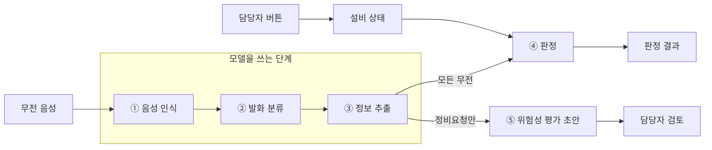

# 레츠 포스꼬우 요구사항 명세서

작성일: 2026-11-09 · 팀 레츠 포스꼬우

## 1. 개요

이 문서는 "AI 복창 확인 시스템"이 해야 하는 일을 요구사항 단위로 정리한다. 기획서의 필수 기능 4개와 현재 저장소의 구현을 기준으로 뽑았고, 요구사항마다 구현 상태를 붙였다.

| 항목 | 내용 |
| --- | --- |
| 시스템 이름 | AI 복창 확인 시스템 |
| 팀 | 레츠 포스꼬우 (5명) |
| 대주제 | AI로 더 안전하고, 멈추지 않고, 더 정확하게 생산하는 제철소 |
| 소주제 | 음성 기반 작업 정보 수집 및 위험성 평가 초안 작성 지원 |
| 한 줄 정의 | 무전으로 오가는 작업 지시를 듣고, 기록(위험성 평가 초안)과 확인(설비 상태·복창 대조)을 만들어 주는 시스템 |

### 1.1 범위

| 구분 | 내용 |
| --- | --- |
| 포함 | 무전 음성의 글자 변환, 발화 분류, 설비·행위·작업 추출, 설비 상태와 지시의 대조, 위험성 평가 초안 작성, 담당자 검토 화면 |
| 제외 | 설비 제어(실제 가동·정지), 가능성·중대성 등급의 자동 산정, 실제 설비 정보 연동, 실시간 무전기 연결 |

### 1.2 사용자

| 사용자 | 하는 일 |
| --- | --- |
| 무전 사용자 (운전실, 현장 작업자) | 평소대로 무전으로 지시하고 복창한다. 시스템을 직접 조작하지 않는다. |
| 담당자 | 인식 문장과 추출 정보를 확인하고, 설비 상태 버튼을 누르고, 위험성 평가 초안을 수정·확정한다. |

### 1.3 용어

| 용어 | 뜻 |
| --- | --- |
| 복창 | 지시를 받은 사람이 내용을 되풀이해 말하는 확인 절차 |
| LOTO | 정비 중 설비가 가동되지 않도록 전원을 잠그고 표지를 거는 조치 |
| 작업허가 | 정비 작업을 시작해도 된다는 허가. 열려 있는 동안 해당 설비는 가동 금지 |
| 장면 | 하나의 작업 상황을 담은 무전 묶음. S01부터 S13까지 13개 |
| 담당자 버튼 | 담당자가 설비 상태를 바꿀 때 누르는 버튼. 정비 시작·완료, LOTO 적용·해제, 작업허가 시작·종료 |
| 판정 | 지시와 설비 상태, 지시와 복창을 규칙으로 대조한 결과. 충돌, 불일치, 확인 필요, 정상, 기록 |
| 초안 | 무전에서 뽑은 작업 정보로 채운 위험성 평가표. 담당자가 확정하기 전 상태 |

## 2. 시스템 개요

무전 음성 한 건은 다섯 단계를 거쳐 두 가지 결과가 된다. 하나는 판정(확인)이고, 다른 하나는 위험성 평가 초안(기록)이다.

③까지는 모델이 문장을 이해하고, ④ 판정은 설비 상태와 규칙만으로 정한다. 초안은 정비요청 무전에서만 만든다.

| 단계 | 하는 일 | 구현 위치 |
| --- | --- | --- |
| ① 음성 인식 | Whisper large-v3로 받아쓰고 표기를 현장 용어로 보정한다 | `stt/src/stt.py` |
| ② 발화 분류 | 정비요청, 가동지시, 정지지시, 복창, 상태보고, 기타로 나눈다 | `cls/src/` |
| ③ 정보 추출 | 설비, 행위, 작업, 받는 무전기를 뽑고 불확실하면 표시한다 | `stt/src/llm_post.py`, `ner_dictionary.csv` |
| ④ 판정 | 설비 상태와 지시, 지시와 복창을 규칙으로 대조한다 | `db/judge.py` |
| ⑤ 위험성 평가 초안 | 정비요청마다 KRAS 양식 엑셀을 만든다 | `risk/src/make_draft.py` |
| 화면 | 녹음·파일 올리기부터 엑셀 받기까지 한 화면에서 처리한다 | `demo_web/app.py` |

### 2.1 설계 원칙

모든 요구사항은 아래 네 가지 원칙을 따른다.

1. **AI는 이해하고, 판정은 규칙이 한다.** 모델은 받아쓰기, 분류, 추출에만 쓴다. 충돌과 불일치는 코드 규칙으로 정한다.
2. **설비 상태는 담당자만 바꾼다.** 무전에 "정비 완료"가 들려도 담당자가 버튼을 눌러야 상태가 바뀐다.
3. **위험 등급은 사람이 매긴다.** 가능성, 중대성, 위험성 칸은 비워 두고 담당자가 입력한다.
4. **모르는 것은 채우지 않고 표시한다.** 설비나 작업을 특정하지 못하면 추정값을 넣지 않고 "확인 필요"로 남긴다.

## 3. 기능 요구사항 (1): 인식, 분류, 추출

음성을 문장으로 바꾸고 그 문장에서 작업 정보를 뽑는 요구사항은 24개이고, 22개가 구현됐다. 남은 2개는 받는 무전기 추출과 추출 결과의 화면 보완이다.

표의 "구분"은 기획서의 필수 기능 4개(음성 입력·텍스트 변환, 작업 정보 추출·미확인 표시, 위험성 평가 초안 생성, 초안 검토·수정·저장)에 해당하면 필수, 그 밖은 확장이다. "상태"는 2026년 11월 9일 저장소 기준이다.

### 3.1 음성 입력·인식

구현 위치: `stt/src/stt.py`, `demo_web/app.py`

| ID | 요구사항 | 구분 | 상태 |
| --- | --- | --- | --- |
| FR-STT-01 | wav 음성을 한국어 문장으로 변환한다 (Whisper large-v3) | 필수 | 구현 |
| FR-STT-02 | 화면에서 마이크로 녹음하거나 wav 파일을 여러 개 올릴 수 있다 | 필수 | 구현 |
| FR-STT-03 | 샘플레이트나 채널 수가 다른 wav도 16kHz 모노로 바꿔 처리한다 | 확장 | 구현 (화면에서만) |
| FR-STT-04 | 현장 용어(컨베이어, 낙광, LOTO, 아이들러 등)를 인식 힌트로 넣는다 | 확장 | 구현 |
| FR-STT-05 | 인식 결과의 표기를 보정한다. 한글 숫자를 아라비아 숫자로(삼 번 → 3번), 로또를 LOTO로, 호출 부호를 영문으로(삐 → B) 바꾼다 | 필수 | 구현 |
| FR-STT-06 | 담당자가 인식 문장을 화면에서 고칠 수 있고, 고치면 분류와 초안을 다시 만든다 | 필수 | 구현 |
| FR-STT-07 | 인식 원문과 보정 문장을 함께 보여준다 | 확장 | 구현 |
| FR-STT-08 | 30초를 넘는 녹음은 앞 30초만 변환하고 경고를 띄운다 | 확장 | 구현 |
| FR-STT-09 | 변환 결과를 저장해 같은 파일은 다시 변환하지 않는다 | 확장 | 구현 |

### 3.2 발화 분류

구현 위치: `cls/src/`, `dictionary/cls_dictionary.csv`

| ID | 요구사항 | 구분 | 상태 |
| --- | --- | --- | --- |
| FR-CLS-01 | 무전 한 건을 정비요청, 가동지시, 정지지시, 복창, 상태보고, 기타 중 하나로 분류한다 | 필수 | 구현 |
| FR-CLS-02 | 규칙 사전, 모델, 불명의 순서로 판단한다. 규칙에 걸리면 모델을 쓰지 않는다 | 확장 | 구현 |
| FR-CLS-03 | 모델 확신도가 0.35보다 낮으면 분류하지 않고 불명으로 둔다 | 필수 | 구현 |
| FR-CLS-04 | 같은 대화의 앞선 분류를 받아, "아니, 5번." 같은 정정 발화를 직전 지시의 종류로 이어받는다 | 확장 | 구현 |
| FR-CLS-05 | 분류 근거(걸린 규칙 이름 또는 모델 확신도)를 결과와 함께 내놓는다 | 확장 | 구현 |
| FR-CLS-06 | 규칙 사전(CSV)에 단어를 추가하면 코드 수정 없이 반영된다 | 확장 | 구현 |

### 3.3 작업 정보 추출

구현 위치: `stt/src/llm_post.py`, `db/db_api.py`, `ner_dictionary.csv`

| ID | 요구사항 | 구분 | 상태 |
| --- | --- | --- | --- |
| FR-NER-01 | 문장에서 설비를 찾아 설비 ID로 바꾼다. 별칭을 인정하고 긴 별칭을 먼저 찾는다 | 필수 | 구현 |
| FR-NER-02 | 행위를 가동, 정지, 정지유지, 가동금지, 가동취소, 리셋 중 하나로 뽑는다 | 필수 | 구현 |
| FR-NER-03 | 작업을 부품과 작업의 짝으로 뽑는다 (예: 롤러 점검, 낙광 청소) | 필수 | 구현 |
| FR-NER-04 | 받는 무전기(호출 부호)를 뽑는다 | 확장 | 일부 구현. 지시의 받는 무전기는 불명이 많아 DB에는 복창에만 넣는다 |
| FR-NER-05 | 규칙으로 채우지 못한 문장만 로컬 LLM(Qwen2.5-3B)으로 다시 해석한다 | 확장 | 구현 |
| FR-NER-06 | LLM이 고른 설비가 등록 설비이고 실제로 들린 번호인지 코드로 다시 확인한다 | 확장 | 구현 |
| FR-NER-07 | 설비를 특정할 수 없으면 추정값을 연결하지 않고, 불확실 표시와 사유를 남긴다 | 필수 | 구현 |
| FR-NER-08 | DB에 없는 설비는 들린 이름만 남긴다 | 필수 | 구현 |
| FR-NER-09 | 담당자가 추출된 설비, 행위, 작업을 화면에서 확인하고 보완한다 | 필수 | 일부 구현. 설비는 화면에 보이지만, 항목별 수정란은 없고 문장을 고쳐 다시 뽑는 방식이다 |

## 4. 기능 요구사항 (2): 설비 상태, 판정, 초안, 화면

판정과 위험성 평가 초안은 코드로 구현됐지만, 판정 결과와 설비 현황판은 아직 시연 화면에 연결되지 않았다. 이 장의 요구사항 34개 중 30개가 구현됐고, 1개는 일부 구현, 3개는 미구현이다.

### 4.1 설비 상태 관리

구현 위치: `db/db_api.py`, `db/state_actions.csv`, `db/state_mapping.csv`

| ID | 요구사항 | 구분 | 상태 |
| --- | --- | --- | --- |
| FR-EQ-01 | 설비마다 상태(운전 가능, 정비 중), LOTO 적용 여부, 작업허가 진행 여부를 저장하고 조회한다 | 확장 | 구현 |
| FR-EQ-02 | 설비 상태는 담당자 버튼 6개로만 바뀐다. 정비 시작·완료, LOTO 적용·해제, 작업허가 시작·종료 | 확장 | 구현 |
| FR-EQ-03 | 상태가 바뀔 때마다 누가, 언제, 어떤 무전을 근거로 바꿨는지 기록한다 | 확장 | 구현 |
| FR-EQ-04 | 무전에서 뽑은 상태 값에 맞는 버튼을 추천한다. "LOTO 걸었습니다"에는 LOTO 적용과 정비 시작을 함께 띄운다 | 확장 | 구현 |
| FR-EQ-05 | 적용인지 해제인지 알 수 없는 오인식(예: "로터")에는 버튼을 추천하지 않고 기록만 한다 | 확장 | 구현 |
| FR-EQ-06 | 장면을 시작 상태로 되돌릴 수 있다 | 확장 | 구현 |
| FR-EQ-07 | 화면에 설비 현황판과 담당자 버튼을 보여준다 | 확장 | 미구현. 시연 화면에 없다 |

### 4.2 판정

구현 위치: `db/judge.py`

| ID | 요구사항 | 구분 | 상태 |
| --- | --- | --- | --- |
| FR-JDG-01 | 무전마다 충돌, 불일치, 확인 필요, 정상, 기록 중 하나로 판정하고 사유를 남긴다 | 확장 | 구현 |
| FR-JDG-02 | LOTO 또는 작업허가가 걸린 설비에 가동 지시가 오면 충돌로 판정한다. 정지 지시는 충돌이 아니다 | 확장 | 구현 |
| FR-JDG-03 | 복창의 설비 번호나 행위(가동, 정지)가 원지시와 다르면 불일치로 판정한다 | 확장 | 구현 |
| FR-JDG-04 | 지시의 설비가 없거나 모호하거나 DB에 없으면 확인 필요로 판정한다. 원지시가 없거나 모호한 복창도 같다 | 확장 | 구현 |
| FR-JDG-05 | 충돌 지시에 대한 복창이 일치해도 충돌을 유지한다 | 확장 | 구현 |
| FR-JDG-06 | 설비 없이 정정하는 지시("아니, 가동.")는 직전 지시의 설비를 이어받는다 | 확장 | 구현 |
| FR-JDG-07 | 무전을 순서대로 읽으며, 각 무전 직전의 설비 상태로 판정한다 | 확장 | 구현 |
| FR-JDG-08 | 판정 결과와 비교한 원지시를 DB에 저장한다 | 확장 | 구현 |
| FR-JDG-09 | 판정 결과를 화면에 보여주고 충돌이면 경고한다 | 확장 | 미구현. 시연 화면에 연결되지 않았다 |

### 4.3 위험성 평가 초안

구현 위치: `risk/src/make_draft.py`, `risk/data/`

| ID | 요구사항 | 구분 | 상태 |
| --- | --- | --- | --- |
| FR-RSK-01 | 정비요청 무전마다 위험성 평가 초안을 1부 만든다 | 필수 | 구현 |
| FR-RSK-02 | 문장에서 찾은 작업(부품 + 작업)에 맞는 위험요인과 감소대책을 기준 표에서 가져온다. 작업이 여러 개면 모두 넣는다 | 필수 | 구현 |
| FR-RSK-03 | 본문은 작업 준비, 작업별 위험요인·감소대책, 작업 마무리의 순서로 채운다 | 필수 | 구현 |
| FR-RSK-04 | 같은 장면에서 뒤에 나온 같은 설비의 상태보고(LOTO 적용, 정비 완료, LOTO 해제)를 작업 기록으로 붙인다 | 필수 | 구현 |
| FR-RSK-05 | 가능성, 중대성, 위험성 칸은 비워 두고 담당자가 입력한다 | 필수 | 구현 |
| FR-RSK-06 | 정비요청에서 설비 번호가 안 들렸으면 바로 뒤 복창의 설비로 채우고 "설비 확인 필요"를 표시한다 | 필수 | 구현 |
| FR-RSK-07 | 작업을 찾지 못하면 공통 항목(작업 준비, 작업 마무리)만 채우고 "작업 미확인"을 표시한다 | 필수 | 구현 |
| FR-RSK-08 | KRAS 양식 엑셀로 내보낸다. 파일 이름은 요청 무전의 녹음 파일 이름을 따른다 | 필수 | 구현 |
| FR-RSK-09 | 초안을 DB(`risk_draft`)에 저장하고, 다시 실행해도 겹치지 않는다 | 필수 | 구현 |
| FR-RSK-10 | 같은 내용을 PDF로도 내보낸다 | 확장 | 일부 구현. S01 결과물 1건과 DB의 `pdf_path` 칸은 있으나 변환 코드는 저장소에 없다 |

### 4.4 검토·수정·저장 화면

구현 위치: `demo_web/app.py` (Streamlit, `run.bat`으로 실행)

| ID | 요구사항 | 구분 | 상태 |
| --- | --- | --- | --- |
| FR-UI-01 | 한 화면에서 녹음 추가, 텍스트 변환, 분류, 위험성 평가 초안의 순서로 보여준다 | 필수 | 구현 |
| FR-UI-02 | 녹음 목록에서 재생, 순서 바꾸기, 삭제를 할 수 있다 | 필수 | 구현 |
| FR-UI-03 | 변환 진행률과 남은 시간을 보여주고, 중간에 멈출 수 있다 | 확장 | 구현 |
| FR-UI-04 | 무전마다 분류 결과, 분류 근거, 찾은 설비를 보여준다 | 필수 | 구현 |
| FR-UI-05 | 초안 표(세부작업, 분류, 위험요인, 감소대책, 가능성, 중대성, 위험성)와 담당자가 확인할 사항을 보여준다 | 필수 | 구현 |
| FR-UI-06 | 초안을 엑셀 파일로 내려받는다 | 필수 | 구현 |
| FR-UI-07 | 녹음 목록(소리, 순서, 고친 문장)을 이름을 붙여 저장하고 다시 불러온다 | 확장 | 구현 |
| FR-UI-08 | 초안 내용을 화면에서 수정하고 확정한다 | 필수 | 미구현. 지금은 내려받은 엑셀에서 수정한다. `risk_draft`에 수정 내용을 담을 칸도 없다 |

## 5. 비기능 요구사항

성능 항목은 현재 측정값을 함께 적었다. 목표 수치는 팀에서 아직 정하지 않았다.

### 5.1 성능

| ID | 요구사항 | 현재 측정값 | 근거 |
| --- | --- | --- | --- |
| NFR-PERF-01 | 보정 후 글자 오류율(CER)을 측정해 관리한다 | 1.57% (보정 전 13.45%), 101건 | `stt/stt_results.csv` |
| NFR-PERF-02 | 보정 후 문장이 대본과 완전히 일치하는 비율을 측정한다 | 101건 중 89건 | `stt/stt_results.csv` |
| NFR-PERF-03 | 발화 한 건의 인식 시간을 측정한다 | 평균 0.238초 (발화 길이 평균 3.15초). 측정 환경은 파일에 기록돼 있지 않다 | `stt/stt_results.csv` |
| NFR-PERF-04 | 판정 결과가 대본의 예상 판정과 일치한다 | 101건 중 101건 일치 | `db/test_judge.py` (2026-11-09 실행) |
| NFR-PERF-05 | 발화 분류의 정확도를 측정한다 | 모델 교차검증 정확도 0.88 (학습 250건). 101건 중 100건은 규칙으로, 1건은 모델로 분류 | `cls/models/config.json` |
| NFR-PERF-06 | 설비 추출 결과를 확정과 불확실로 나눠 센다 | 101건 중 설비 ID 확정 93건, 불확실 표시 10건 (설비 언급이 없는 무전도 있다) | `stt/llm_results.csv` |

예상 판정 101건의 구성은 정상 61건, 충돌 19건, 기록 12건, 불일치 5건, 확인 필요 4건이다.

### 5.2 안전·신뢰성

| ID | 요구사항 |
| --- | --- |
| NFR-SAFE-01 | 충돌과 불일치 판정에는 모델을 쓰지 않는다. 판정은 코드 규칙으로만 한다 |
| NFR-SAFE-02 | 모델 출력만으로 설비 상태를 바꾸지 않는다. 상태 변경에는 담당자의 버튼 입력이 필요하다 |
| NFR-SAFE-03 | LLM이 고른 설비는 코드로 다시 확인한 뒤에만 쓴다 |
| NFR-SAFE-04 | 특정하지 못한 설비와 작업은 추정해서 채우지 않는다 |
| NFR-SAFE-05 | 음성과 문장은 로컬 PC에서 처리한다. Whisper와 Qwen 모델은 처음 실행할 때 내려받아 로컬에서 실행한다 |

### 5.3 추적성

| ID | 요구사항 |
| --- | --- |
| NFR-TRC-01 | 판정마다 사유와 비교한 원지시를 남긴다 |
| NFR-TRC-02 | 설비 상태 변경마다 변경자, 시각, 근거 무전을 남긴다 |
| NFR-TRC-03 | 분류마다 근거(규칙 이름 또는 모델 확신도)를 남긴다 |
| NFR-TRC-04 | 초안은 요청 무전에 연결하고, 엑셀 파일 이름으로 원본 녹음을 찾을 수 있게 한다 |
| NFR-TRC-05 | 위험요인·감소대책 행마다 원본 문서, 행 번호, 원문 그대로인지 단어를 바꿨는지를 보관한다 |

### 5.4 실행 환경·유지보수

| ID | 요구사항 |
| --- | --- |
| NFR-ENV-01 | Python 3.13에서 동작한다 |
| NFR-ENV-02 | GPU가 있으면 쓰고, 없으면 CPU로 동작한다 |
| NFR-ENV-03 | DB는 SQLite 파일 하나로 두고, 스크립트(`db/build_db.py`)로 언제든 다시 만든다. DB 파일은 저장소에 올리지 않는다 |
| NFR-ENV-04 | 용어와 분류 규칙은 사전 CSV에 줄을 추가해 늘린다 |
| NFR-ENV-05 | DB 함수와 판정 규칙은 자동 시험으로 확인한다. 2026년 11월 9일 실행 결과는 DB 함수 32개 통과, 판정 101건 일치다 |
| NFR-ENV-06 | 화면은 Windows에서 `run.bat` 실행만으로 뜬다 |

## 6. 데이터 요구사항

데이터는 SQLite 표 10개와 사전 CSV 2개에 담는다. 설비, 무전, 위험요인 표는 모두 시연용 데이터다.

### 6.1 DB 표

건수는 `build_db.py --with-stt --classify --with-llm-results --with-risk-data`로 만든 DB 기준이다.

| 표 | 담는 것 | 건수 |
| --- | --- | --- |
| `equipment` | 설비 목록 | 8 |
| `equipment_alias` | 설비 별칭 (문장에서 설비를 찾을 때 사용) | 27 |
| `equipment_state` | 설비별 현재 상태, LOTO 적용 여부, 작업허가 진행 여부 | 8 |
| `radio_message` | 무전 한 건: 장면, 녹음 파일, 무전기, 문장, 분류, 분류 근거, 행위 | 101 |
| `message_equipment` | 무전과 설비의 연결, 들린 이름 | 96 |
| `state_change_log` | 담당자 버튼 기록 | 버튼을 누를 때 쌓임 |
| `judgment` | 판정, 사유, 비교한 원지시 | 판정 실행 시 무전당 1건 |
| `risk_template` | 작업 종류 (부품 + 작업) | 9 |
| `risk_step` | 작업별 위험요인과 감소대책 | 57 |
| `risk_draft` | 초안: 요청 무전, 작업, 상태, 설비, 엑셀·PDF 경로 | 초안 생성 시 쌓임 |

### 6.2 데이터 규칙

| ID | 규칙 |
| --- | --- |
| DR-01 | 설비 ID는 종류와 번호로 적는다 (CV-03, CR-01, FN-02) |
| DR-02 | 설비 상태(`status`)는 READY와 MAINTENANCE 두 값만 쓴다. 충돌 판정에는 `status`가 아니라 `loto_applied`와 `permit_open`을 쓴다 |
| DR-03 | 분류는 7개 값(6종 + 불명), 판정은 5개 값, 담당자 버튼은 6개 값만 저장할 수 있다 |
| DR-04 | 녹음 파일 이름은 장면, 순번, 무전기 순서로 짓는다 (S01\_03\_B.wav) |
| DR-05 | 작업허가를 종료할 때 LOTO가 걸려 있지 않으면 설비 상태도 READY로 바꾼다 |
| DR-06 | 기준 표의 가능성, 중대성, 위험성은 비워 둔다 (57행 모두 빈칸) |
| DR-07 | 초안 상태는 DRAFT로 시작한다. 스키마 문서에는 담당자 확정 값으로 APPROVED가 정의돼 있으나, 이 값으로 바꾸는 코드는 없다 |
| DR-08 | 설비를 특정할 수 없는 말("이번 컨베이어")은 별칭에 넣지 않는다 |

### 6.3 사전과 기준 데이터

| 파일 | 내용 | 건수 |
| --- | --- | --- |
| `ner_dictionary.csv` | 용어, 라벨, 정규값, 출처. 라벨은 EQUIP, PART, ACTION, STATE, TASK, EQUIP\_TYPE, CUE, HAZARD, RADIO | 195 |
| `dictionary/cls_dictionary.csv` | 분류 규칙 (우선순위, 분류, 패턴, 조건) | 50 |
| `db/state_actions.csv` | 버튼별로 바뀌는 칸 | 6 |
| `db/state_mapping.csv` | 무전의 상태 값과 추천 버튼의 대응 | 15 |
| `db/scenes.csv` | 장면별 시작 상태와 버튼을 누르는 시점 | 6 |
| `db/expected_judgments.csv` | 대본의 예상 판정 | 101 |
| `risk/data/risk_template.csv`, `risk_step.csv` | 작업 9종과 위험요인·감소대책 57행 | 9, 57 |
| `risk/data/source_rows.csv` | 기준 표의 바탕이 된 원문 | 15 |
| `risk/data/kras_template.xlsx` | KRAS 양식 원본 | 1 |
| `recordings/` | 무전 녹음 wav, 13개 장면 | 101 |

위험요인·감소대책 57행은 한국가스공사 위험성평가 표준모델 문장을 바탕으로 만든 예시다. 21행은 원문 그대로이고 36행은 설비, 부품, 작업 단어를 바꿨다. 실제 사업장의 평가 자료가 아니다.

## 7. 인터페이스 요구사항

사용자가 만나는 인터페이스는 시연 화면 하나이고, 모듈끼리는 Python 함수와 DB로 주고받는다.

### 7.1 화면 구성

| 영역 | 보여주는 것과 할 수 있는 일 |
| --- | --- |
| ① 녹음 추가 | 마이크 녹음, wav 파일 여러 개 올리기 |
| ② 텍스트 변환 | 녹음별 재생, 변환, 문장 수정, 인식 원문 확인, 결과 저장, 다시 변환, 순서 이동, 삭제 |
| ③ 분류 | 녹음별 분류 결과, 분류 근거, 찾은 설비 |
| ④ 위험성평가 초안 | 정비요청마다 탭 하나: 공정명, 요청 무전, 작업 기록, 초안 표, 확인할 사항, 엑셀 받기 |
| 옆 메뉴 | 녹음 목록을 이름 붙여 저장, 불러오기, 삭제 |

### 7.2 모듈 입출력

| 모듈 | 호출 | 입력 | 출력 |
| --- | --- | --- | --- |
| 음성 인식 | `STT().transcribe(audio)` | 16kHz 모노 음성, 30초 이하 | 인식 원문 |
| 표기 보정 | `postprocess(text)` | 인식 원문 | 보정 문장 |
| 발화 분류 | `UtteranceClassifier().predict(text, history)` | 문장, 앞선 분류 목록 | 분류(`cls`), 확신도(`score`), 근거(`rule`), 1순위 후보(`top`) |
| 정보 추출 | `python llm_post.py` | 인식 결과 CSV | 무전별 보정 문장, 설비 ID, 들린 설비 이름, 행위, 작업, 받는 무전기, 불확실 여부와 사유 |
| 설비 찾기 | `db_api.find_equipment(text)` | 문장 | 설비 ID와 들린 이름의 목록 |
| 설비 상태 | `db_api.get_state(id)` | 설비 ID | 상태, LOTO, 작업허가, 가동 막힘 여부(`start_blocked`) |
| 담당자 버튼 | `db_api.press_button(id, action, msg_id)` | 설비 ID, 버튼, 근거 무전 | 바뀐 뒤의 상태 (기록도 함께 남김) |
| 판정 | `judge.judge_scene(scenario_id)` | 장면 ID | 무전별 판정과 사유 (DB에도 저장) |
| 초안 작성 | `make_draft.make_draft(...)`, `export_excel(...)` | 요청 무전, 같은 장면의 무전 목록 | 설비, 확인할 사항, 초안, 작업 기록, 엑셀 파일 |

### 7.3 파일 형식

| 구분 | 형식 |
| --- | --- |
| 입력 음성 | wav. 화면은 샘플레이트와 채널 수를 가리지 않는다. `stt.py`를 직접 실행할 때는 16kHz 모노 16bit만 받는다 |
| 초안 출력 | `<녹음 파일 이름>_위험성평가.xlsx` (KRAS 양식) |
| 기록 반영본 | `--records-in-body` 옵션을 주면 무전 기록을 본문 칸에도 채운 `_위험성평가_기록반영.xlsx`를 함께 만든다 |

## 8. 구현 현황, 제약

기능 요구사항 58개 중 52개가 구현됐고, 3개는 일부 구현, 3개는 미구현이다. 미구현 3개는 모두 시연 화면에 관한 것이다.

### 8.1 구현 현황

| 영역 | 요구사항 | 구현 | 일부 구현 | 미구현 |
| --- | --- | --- | --- | --- |
| 음성 입력·인식 | 9 | 9 | 0 | 0 |
| 발화 분류 | 6 | 6 | 0 | 0 |
| 작업 정보 추출 | 9 | 7 | 2 | 0 |
| 설비 상태 관리 | 7 | 6 | 0 | 1 |
| 판정 | 9 | 8 | 0 | 1 |
| 위험성 평가 초안 | 10 | 9 | 1 | 0 |
| 검토·수정·저장 화면 | 8 | 7 | 0 | 1 |
| 합계 | 58 | 52 | 3 | 3 |

### 8.2 제약과 가정

- 설비 8대, 무전 101건, 위험요인 표는 시연용 데이터다. 실제 설비 정보와 연동하지 않는다.
- 녹음된 wav 파일과 화면에서 녹음한 음성을 처리한다. 무전기와 실시간으로 연결하지 않는다.
- 무전 한 건은 30초 이하로 가정한다.
- 초안은 정비요청 무전에서만 만든다. 101건 중 정비요청은 8건이다.
- 판정은 한 장면의 무전이 순서대로 들어온다고 가정한다.
- 판정을 장면 단위로 실행할 때는 담당자 버튼을 누르는 시점을 `db/scenes.csv`에 미리 정해 둔 대로 따른다.
- 시연 화면 폴더(`demo_web/`)는 분류, DB, 초안, 인식 코드의 복사본을 따로 갖는다. 지금은 원본과 같지만, 원본을 고치면 복사본도 맞춰야 한다.
